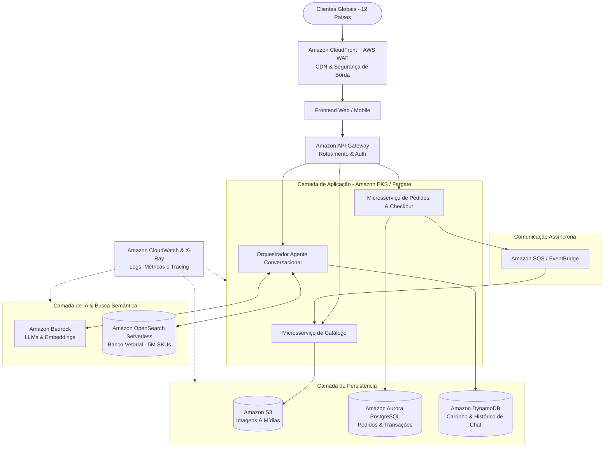
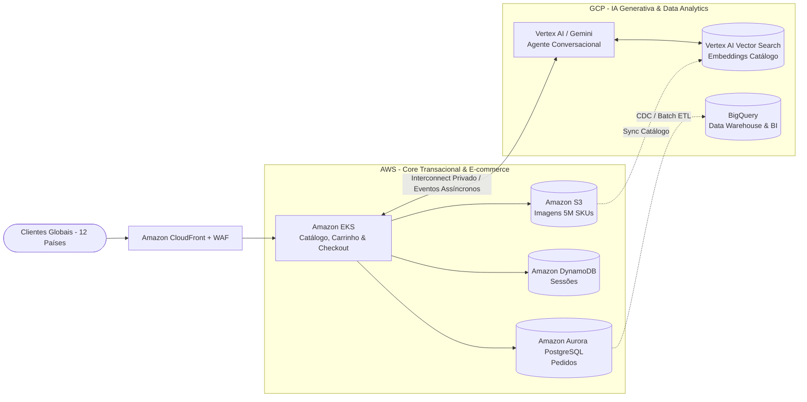

## 🟢 Nível 1 — Básico: Consolidando os Fundamentos
### Exercício 1.1 — Mapeamento de modelos de serviço
Para cada serviço, identifique-se como IaaS, PaaS, SaaS ou FaaS. Justifique em uma frase.


| Serviço | Modelo (IaaS/PaaS/SaaS/FaaS) | Justificativa |
| :--- | :--- | :--- |
| Gmail | SaaS | Software pronto para uso final acessado pelo navegador, sem necessidade de gerenciar servidores ou código. |
| Amazon EC2 | IaaS | Fornece máquinas virtuais (computação e rede), mas exige que você gerencie o sistema operacional, atualizações e aplicações. |
| AWS Elastic Beanstalk (hospedar uma API) | PaaS | Abstrai o gerenciamento da infraestrutura e do sistema operacional, permitindo focar apenas no deploy do código da aplicação. |
| AWS Lambda | FaaS | Executa trechos de código sob demanda orientados a eventos, sem provisionamento de servidores e com cobrança por execução. |
| Amazon RDS para PostgreSQL | PaaS | Banco de dados gerenciado onde a AWS cuida do provisionamento, backups e patches, enquanto você administra apenas os dados e schemas. |
| Salesforce CRM | SaaS | Plataforma completa de gestão de clientes entregue pronta pela nuvem, sem gestão de infraestrutura pelo usuário. |
| Google Kubernetes Engine (GKE) | PaaS/IaaS (Híbrido) | O Google gerencia o control plane do Kubernetes (PaaS), mas você ainda configura e administra os nós de trabalho e pods (IaaS). |
| Amazon S3 | PaaS (Storage gerenciado) | Serviço de armazenamento de objetos totalmente gerenciado, no qual você controla apenas os buckets, dados e permissões de acesso. |
| Amazon Bedrock | SaaS / API como serviço | Disponibiliza modelos fundacionais de IA prontos para consumo direto via API, sem exigir gerenciamento de infraestrutura ou treinamento base. |
**


---

### Exercício 1.2 — Os 6 Rs na prática

Leia cada cenário e escolha o R de migração mais adequado (Rehost, Replatform, Refactor, Repurchase, Retire, Retain). Justifique.

* **Cenário A:** Empresa de logística com sistema de rastreamento de frotas em servidor físico próprio. Código de 2008, sem documentação, só uma pessoa sabe mexer. Quer migrar rápido para ganhar elasticidade.
  * **Resposta:** Rehost
  * **Justificativa:** Como o sistema é antigo (2008), não possui documentação, tem baixa disponibilidade de conhecimento técnico interno e a prioridade é migrar rapidamente para ganhar elasticidade, mover a máquina virtual diretamente para a nuvem (ex.: Amazon EC2) sem alterar o código é a abordagem mais segura e ágil.
  
* **Cenário B:** Banco regional usa ERP local de RH. Análise mostra: menos de 5 usuários ativos por mês, dados raramente consultados.
  * **Resposta:** Retire
  * **Justificativa:** O sistema possui baixíssima utilização (menos de 5 usuários ativos por mês) e dados raramente consultados; desativá-lo (arquivando os dados históricos caso haja exigência legal) elimina custos desnecessários de manutenção e infraestrutura.
  
* **Cenário C:** Fintech tem API de pagamentos monolítica. Decida aproveitar a migração para refatorar em microserviços com K8s e orientado a eventos.
  * **Resposta:** Refactor
  * **Justificativa:** A empresa decidiu reescrever a aplicação monolítica para uma arquitetura nativa em nuvem baseada em microsserviços, Kubernetes e eventos, visando escalabilidade e agilidade de entrega.
  
* **Cenário D:** Varejo usa CRM desenvolvido internamente há 15 anos. SaaS de mercado atende 90% das necessidades por menor custo.
  * **Resposta:** Repurchase
  * **Justificativa:** Como um produto SaaS de mercado já atende 90% das necessidades por um custo menor do que manter um legado interno de 15 anos, substituir a solução própria por uma assinatura comercial é a escolha mais eficiente.
  
* **Cenário E:** Instituição financeira tem mainframe com dados de clientes que precisam ficar on-premise por exigência do Banco Central.
  * **Resposta:** Retain
  * **Justificativa:** Devido a restrições regulatórias e de conformidade impostas pelo Banco Central, os dados precisam permanecer em ambiente *on-premise*, mantendo a carga de trabalho localmente enquanto outras partes do ecossistema podem ser integradas via arquitetura híbrida.

---

### Exercício 1.3 — Calculando o impacto do SLA

Sistema de e-commerce com SLA de 99,9%.

a) Quantas horas de inatividade por ano? b) Se processa R$ 50.000/hora em vendas, qual o impacto financeiro máximo por ano? c) Para reduzir o impacto para menos de R$ 50.000/ano, qual SLA mínimo seria necessário?

> **Fórmulas úteis:** Downtime anual (horas) = 8.760 × (1 - SLA/100) | Downtime mensal (min) = 43.800 × (1 - SLA/100)

* **a) Horas de inatividade por ano (SLA 99,9%):**
  $$\text{Downtime anual} = 8.760 \times \left(1 - \frac{99,9}{100}\right) = 8.760 \times 0,001 = \mathbf{8,76\text{ horas/ano}}\text{ (aproximadamente 8h 45min 36s)}$$

* **b) Impacto financeiro máximo por ano:**
  * `Impacto financeiro = 8,76 horas × R$ 50.000/hora` = **R$ 438.000,00/ano**

* **c) SLA mínimo para reduzir o impacto para menos de R$ 50.000/ano:**
  * Primeiro, calcula-se o limite máximo de horas de indisponibilidade permitido:
    `Downtime máximo < R$ 50.000 / (R$ 50.000/hora)` → **< 1 hora/ano**
  * Aplicando na fórmula de SLA anual:
    `8.760 × (1 - SLA / 100) < 1` → `1 - SLA / 100 < 1 / 8.760` (`≈ 0,00011415`)
    `SLA > (1 - 0,00011415) × 100` = **99,9886%**
  * **Conclusão:** Seria necessário um SLA mínimo de **99,99%** ("quatro noves"), o que limitaria a inatividade anual a **0,876 horas** (cerca de 52 minutos e 33 segundos), gerando um impacto máximo de **R$ 43.800,00/ano**.
 
---

### Exercício 1.4 — IAM na prática

Você é o responsável pela segurança da Quantum Commerce. Para cada perfil abaixo, escolha a política gerenciada da AWS (ou descreva a política customizada) mais adequada e justificada:

| Perfil | Política IAM mais adequada | Justificativa |
| :--- | :--- | :--- |
| Agente de IA que LÊ produtos do S3 para responder ao cliente | Política customizada com `s3:GetObject` e `s3:ListBucket` restrita ao ARN do bucket/prefixo específico | Aplica o princípio do menor privilégio, evitando conceder `AmazonS3ReadOnlyAccess` que exporia todos os outros buckets da conta. |
| Engenheiro de dados que CARREGA novos catálogos no S3 | Política customizada com `s3:PutObject` restrita ao prefixo `catalogo/` | Permite apenas o envio de novos arquivos no diretório específico de catálogos, impedindo alterações ou exclusões indevidas em outros dados. |
| Time de FinOps que precisa VER custos sem alterar recursos | `AWSBillingReadOnlyAccess` (política gerenciada pela AWS) | Garante acesso de leitura às informações de faturamento e Cost Explorer para análise financeira, sem permissão para criar, modificar ou excluir recursos. |
| Auditor externo que precisa LER configurações de toda a conta | `SecurityAudit` ou `ViewOnlyAccess` via IAM Role assumida | Permite inspecionar configurações e metadados de segurança de toda a conta sem alterar recursos, usando credenciais temporárias (sem usuário IAM permanente). |
| Sistema de CI/CD que provisiona infraestrutura via Terraform | IAM Role dedicada assumida via OIDC (ex.: GitHub Actions) com política customizada restrita aos serviços do projeto | Elimina o uso de chaves de acesso fixas (`Access Keys`) e limita o provisionamento apenas aos recursos necessários, evitando conceder `AdministratorAccess`. |


---

## 🟡 Nível 2 — Intermediário: Arquitetura em Nuvem

### Exercício 2.1 — Arquitetura de alto nível: Quantum Commerce

**Contexto:** A Quantum Commerce é um gigante do e-commerce com 12 países, 5M de SKUs, e quer transformar a experiência de compra com IA conversacional.

#### 1. Camadas da arquitetura

A arquitetura proposta é dividida em **6 camadas principais** para garantir escala global, baixa latência e resiliência entre os 12 países:

* **Camada de Borda e Entrega (Edge / Frontend):** Responsável por hospedar a interface web/mobile, distribuir conteúdo estático (imagens e vídeos dos 5M de SKUs) com baixa latência global via CDN e proteger a borda contra ataques DDoS e bots (WAF).
* **Camada de Entrada e Roteamento (API Gateway):** Ponto único de entrada que gerencia autenticação/autorização, *rate limiting*, roteamento geográfico e orquestração das requisições entre o frontend e os microsserviços internos.
* **Camada de Aplicação e Negócio (Backend / Microsserviços):** Contém os serviços desacoplados de catálogo, carrinho, checkout, pedidos e o orquestrador do agente de IA conversacional, comunicando-se de forma assíncrona via filas e eventos.
* **Camada de IA Generativa e Busca Semântica (AI / ML):** Gerencia os modelos fundacionais (LLMs) para atendimento conversacional, geração de embeddings dos produtos e busca vetorial (RAG) para recomendações personalizadas em tempo real sobre os 5 milhões de SKUs.
* **Camada de Persistência de Dados (Dados):** Armazena dados transacionais críticos (pedidos e pagamentos em banco relacional), sessões de chat e carrinhos em alta velocidade (NoSQL), índices vetoriais do catálogo e mídias em object storage.
* **Camada de Observabilidade e Governança:** Coleta logs distribuídos, métricas de infraestrutura/negócio, traces das chamadas de IA e alertas automatizados, além de gerenciar políticas de acesso (IAM) e segredos.

---

#### 2. Provedor principal escolhido e justificativa

* **Provedor escolhido:** **AWS (Amazon Web Services)**
* **Justificativa:**
  * **Capilaridade Global:** Possui regiões e *Edge Locations* (CloudFront) distribuídas estrategicamente na América do Norte, Europa, América Latina e Ásia, atendendo aos 12 países com baixa latência e conformidade de residência de dados (como LGPD e GDPR).
  * **Maturidade em IA Generativa (Amazon Bedrock):** Permite consumir múltiplos modelos fundacionais via API gerenciada com segurança empresarial, sem que os dados proprietários da Quantum Commerce sejam usados para treinar modelos públicos.
  * **Escala Comprovada em E-commerce:** Serviços nativos como DynamoDB (latência de milissegundos em qualquer escala), EKS/ECS e OpenSearch Serverless suportam picos extremos de tráfego (como Black Friday) sobre 5M de SKUs sem gargalos operacionais.

---

#### 3. Serviços por categoria

| Categoria | AWS | Alternativa Azure | Alternativa GCP |
| :--- | :--- | :--- | :--- |
| Computação (backend) | Amazon EKS / AWS Fargate | Azure Kubernetes Service (AKS) / Azure Container Apps | Google Kubernetes Engine (GKE) / Cloud Run |
| Armazenamento (catálogo, imagens) | Amazon S3 | Azure Blob Storage | Google Cloud Storage (GCS) |
| Banco relacional | Amazon Aurora / Amazon RDS (PostgreSQL) | Azure Database for PostgreSQL / Azure SQL | Cloud SQL / AlloyDB for PostgreSQL |
| Banco NoSQL | Amazon DynamoDB | Azure Cosmos DB | Cloud Firestore / Cloud Bigtable |
| Banco de dados vetorial | Amazon OpenSearch Serverless (Vector Engine) / pgvector no Aurora | Azure AI Search / Cosmos DB (Vector) | Vertex AI Vector Search / AlloyDB (pgvector) |
| Serviços de IA cognitivos | Amazon Bedrock | Azure OpenAI Service / Azure AI Foundry | Vertex AI (Gemini) |
| CDN | Amazon CloudFront | Azure Front Door / Azure CDN | Cloud CDN |
| Mensageria/Filas | Amazon SQS / Amazon EventBridge | Azure Service Bus / Azure Event Grid | Cloud Pub/Sub |
| Observabilidade (logs/métricas) | Amazon CloudWatch / AWS X-Ray | Azure Monitor / Application Insights | Cloud Logging / Cloud Monitoring / Cloud Trace |

---

#### 4. Diagrama de Arquitetura (Mermaid)

> Abaixo está o diagrama em código **Mermaid** (renderizado automaticamente pelo GitHub) e que também pode ser exportado ou recriado no **Excalidraw** / **draw.io** para anexar a imagem conforme solicitado na entrega.



---

### Exercício 2.2 — Comparativo de custos: 3 fornecedores

Você precisa recomendar infraestrutura para um projeto de Engenharia de IA. Use as calculadoras para comparar:

* 2 VMs com 2 vCPUs e 8 GB de RAM (Linux, 24/7)
* 500 GB de armazenamento de objetos
* 1 banco gerenciado com 2 vCPUs / 8 GB RAM / 100 GB
* 10 milhões de requisições/mês para função serverless

> **Premissas da simulação:** Região `us-east-1` / `East US` / `us-central1`, modelo *On-Demand* (730 h/mês), banco relacional PostgreSQL (Single-AZ, 100 GB SSD) e função serverless configurada com 512 MB de memória e duração média de 200 ms por execução (incluindo o *Free Tier* mensal padrão).

| Item | AWS | Azure | GCP | Notas |
| :--- | :--- | :--- | :--- | :--- |
| 2 × VM (2 vCPUs/8 GB) | US$ 121,47 | US$ 121,18 | US$ 97,85 | **Tipo:** AWS `t3.large` / Azure `Standard_B2ms` / GCP `e2-standard-2` |
| 500 GB de armazenamento | US$ 11,50 | US$ 10,40 | US$ 10,00 | **Tipo:** S3 Standard / Azure Blob Hot (LRS) / Cloud Storage Standard |
| Banco relacional gerenciado | US$ 107,07 | US$ 107,50 | US$ 92,35 | **Tipo:** RDS `db.t3.large` / Azure PostgreSQL Flexible `B2ms` / Cloud SQL `db-custom-2-8192` |
| 10 milhões de requisições serverless | US$ 16,67 | US$ 16,00 | US$ 18,40 | **Tipo:** AWS Lambda / Azure Functions / Cloud Run Functions (512 MB, 200 ms) |
| **Total mensal** | **US$ 256,71** | **US$ 255,08** | **US$ 218,60** | Valores estimados em dólar (USD) sob demanda (*On-Demand*) |
| **Total anual** | **US$ 3.080,52** | **US$ 3.060,96** | **US$ 2.623,20** | Projeção linear de 12 meses sem reservas |

#### Análise

* **a) Qual provedor ficou mais barato? A diferença é significativa?**
  * O **GCP (Google Cloud Platform)** apresentou o menor custo mensal (**US$ 218,60/mês**), gerando uma economia aproximada de **14,3% a 14,8%** (cerca de **US$ 36 a US$ 38 por mês**, ou **~US$ 440 a US$ 457 por ano**) em comparação com a AWS e o Azure, que ficaram praticamente empatados na faixa de **US$ 255 a US$ 257/mês**. Para cargas contínuas de menor porte, a diferença anual é relevante no orçamento, embora em grandes arquiteturas corporativas contratos corporativos e créditos de nuvem costumem equilibrar esses valores.

* **b) Aplicando Instâncias Reservadas de 1 ano no mais caro, o resultado muda?**
  * **Sim, o resultado muda e o provedor mais caro passa a ser o mais barato.** Aplicando um plano de compromisso de 1 ano (*Savings Plans / Reserved Instances* sem pagamento adiantado) na **AWS** (que teve o maior valor *On-Demand* de US$ 256,71), obtém-se um desconto médio de **~35% a 40%** na computação (EC2) e no banco de dados (RDS):
    * **2 × EC2 (`t3.large` - 1 ano reservado):** cai de US$ 121,47 para **~US$ 76,50/mês**
    * **RDS (`db.t3.large` - 1 ano reservado):** cai de US$ 107,07 para **~US$ 69,60/mês**
    * **Novo total mensal na AWS:** **~US$ 174,27/mês** (**US$ 2.091,24/ano**), superando o preço *On-Demand* do GCP (US$ 218,60/mês). *(Nota: se o GCP também aplicar Committed Use Discounts de 1 ano, ele volta a disputar a liderança na faixa de ~US$ 155–165/mês).*

* **c) Além do preço, que outros fatores você consideraria para um projeto de IA?**
  * **Ecossistema de Modelos Fundacionais e APIs Gerenciadas:** Disponibilidade e variedade de LLMs de ponta sem precisar gerenciar GPUs (ex.: *Amazon Bedrock* com Claude/Llama, *Azure OpenAI Service* com modelos GPT ou *GCP Vertex AI* com Gemini).
  * **Disponibilidade e Custo de GPUs/TPUs:** Facilidade para obter cotas (*quotas*) de instâncias aceleradas (NVIDIA L4, A100, H100) caso o projeto exija *fine-tuning* ou inferência de modelos próprios.
  * **Integração com Bancos Vetoriais e Pipelines de Dados:** Suporte nativo a busca vetorial (RAG), governança de dados, segurança empresarial (privacidade de prompts, isolamento de rede via VPC/PrivateLink) e conformidade regulatória (LGPD/GDPR).
  * **Maturidade da Equipe e *Vendor Lock-in*:** Conhecimento técnico atual do time de engenharia e portabilidade da arquitetura usando ferramentas abertas (Terraform, Kubernetes, Docker, LangChain).

#### Calculadoras utilizadas

* **AWS:** https://calculator.aws
* **Azure:** https://azure.microsoft.com/pricing/calculator
* **GCP:** https://cloud.google.com/products/calculator

---

### Exercício 2.3 — Estratégia de migração para sua empresa

Pense no seu contexto profissional atual (ou empresa que conhece bem).

a) Descreva um sistema/carga de trabalho (sem dados permitidos — pode ser genérico) b) Qual dos 6 Rs você aplicaria? Justifique custo, risco, ganho, prazo c) Que serviço AWS usaria? Estimativa mensal? d) Maior obstáculo técnico ou organizacional? Como endereçaria?

#### Resposta — Contexto: Caso 1 - Plataforma de Analytics, Inteligência de Negócios e Conciliação Pós-Transacional (Rede Global de Pagamentos)

* **a) Descrição do sistema / carga de trabalho:**
  * Trata-se de um **portal interno e pipeline analítico de conciliação e inteligência de transações (pós-autorização)** utilizado por times de BI, FinOps e parceiros emissores para consultar históricos de liquidação, relatórios de *chargeback* e métricas de volume transacional.
  * **Importante (Escopo de Segurança):** Não envolve o motor de autorização em tempo real (que exige latência sub-segundo em mainframe/rede proprietária), operando exclusivamente sobre dados históricos anonimizados/tokenizados em janelas D-1 (*batch* e micro-lotes). Atualmente roda em servidores físicos/virtuais *on-premise* com banco de dados relacional legado, sofrendo com lentidão no fechamento mensal e dificuldade para escalar consultas analíticas em datas sazonais (como Black Friday e Natal).

* **b) Estratégia dos 6 Rs aplicada e justificativa (Custo, Risco, Ganho e Prazo):**
  * **Estratégia escolhida:** **Replatform (*Lift, Tinker and Shift*)** — migrar a aplicação web/APIs para contêineres gerenciados e substituir o banco relacional legado por um banco gerenciado e um *data warehouse* em nuvem, sem precisar reescrever toda a lógica de negócio do zero.
  * **Custo:** Redução de CapEx (renovação de hardware *on-premise* e licenças de banco proprietário) e otimização de OpEx por meio de escalonamento automático (pagando por capacidade extra apenas nos picos de fechamento mensal e datas sazonais).
  * **Risco:** **Baixo a moderado**, pois a lógica central da aplicação e o modelo de dados permanecem os mesmos, evitando o alto risco de bugs e regressões de uma reescrita completa (*Refactor*), ao mesmo tempo em que isola a carga analítica do ambiente crítico de autorização de cartões.
  * **Ganho:** Redução drástica no tempo de processamento dos relatórios de conciliação (de horas para minutos), eliminação de gargalos de I/O no banco de dados e facilidade para integrar futuramente modelos de detecção de anomalias e IA generativa.
  * **Prazo:** **Curto a médio prazo (3 a 5 meses)**, permitindo entrega incremental por módulos de relatórios sem interromper a operação diária dos analistas.

* **c) Serviços AWS recomendados e estimativa mensal:**
  * **Arquitetura AWS:**
    * **Computação / APIs:** **Amazon ECS com AWS Fargate** (execução *serverless* de contêineres para o portal e microsserviços de relatórios).
    * **Banco Transacional / Metadados:** **Amazon RDS for PostgreSQL (Multi-AZ)** para controle de usuários, agendamentos e metadados do portal.
    * **Camada Analítica / Data Warehouse:** **Amazon Redshift Serverless** + **Amazon S3** (armazenamento de dados históricos tokenizados em formato Parquet).
    * **Segurança e Conectividade:** **AWS Direct Connect** (conexão privada dedicada com o data center), **AWS KMS** (criptografia com chaves gerenciadas pelo cliente) e **AWS IAM**.
  * **Estimativa mensal aproximada (ambiente de produção corporativo moderado):**
    * **Amazon ECS / Fargate** (4 tarefas contínuas com 2 vCPUs / 4 GB RAM): ~**US$ 240,00/mês**
    * **Amazon RDS PostgreSQL Multi-AZ** (`db.r6g.large`): ~**US$ 350,00/mês**
    * **Amazon Redshift Serverless** (uso sob demanda ~32 RPUs por 4h/dia): ~**US$ 1.440,00/mês**
    * **Amazon S3 + AWS KMS + CloudWatch** (5 TB armazenados + logs e auditoria): ~**US$ 180,00/mês**
    * **Total estimado:** **~US$ 2.210,00/mês** (cerca de **US$ 26.520,00/ano**, sujeito a descontos de contratos corporativos / *Enterprise Discount Program*).

* **d) Maior obstáculo técnico ou organizacional e como endereçaria:**
  * **Maior obstáculo:** **Conformidade regulatória rigorosa (PCI-DSS, LGPD/GDPR) e governança interna de segurança da informação**, que geram resistência das áreas de Risco e Arquitetura Corporativa para mover qualquer dado originado de transações financeiras para a nuvem pública.
  * **Como endereçaria:**
    1. **Escopo Zero-PCI (*Tokenization* na origem):** Garantir arquiteturalmente que nenhum dado sensível de titular de cartão (PAN/CVV) saia do ambiente *on-premise* — enviando para a AWS apenas identificadores tokenizados e dados agregados, reduzindo drasticamente o escopo de auditoria PCI-DSS.
    2. **Landing Zone e Controles Preventivos:** Utilizar a *Landing Zone* corporativa já homologada com **AWS Organizations (SCPs)**, tráfego
   
#### Resposta — Contexto: Caso 2 - Portal Corporativo de *Supply Chain* e Desenvolvimento de Produtos (Varejo de Moda)

- **a) Descrição do sistema / carga de trabalho:**
  - Trata-se de um **portal corporativo de *Supply Chain* e desenvolvimento de produtos** de uma grande varejista de moda brasileira, utilizado por aproximadamente **800 profissionais internos** (desenvolvimento de produto, estilo e compras) e **mais de 450 fornecedores globais** para planejamento de coleções, negociação, aprovação e acompanhamento de pedidos até o recebimento nos Centros de Distribuição (CDs).
  - **Importante (Escopo e Gargalo Atual):** Opera sobre uma versão antiga e altamente customizada do **Microsoft Dynamics CRM**. O principal ponto de falha está nas integrações síncronas e frágeis com o **Oracle Retail Merchandising System (RMS)**, que geram quedas de comunicação, necessidade de reprocessamento manual e inconsistências nos pedidos e prazos de entrega.

- **b) Estratégia dos 6 Rs aplicada e justificativa (Custo, Risco, Ganho e Prazo):**
  - **Estratégia escolhida:** **Refactor (*Re-arquitetar*) incremental** — iniciar pela desacoplagem e modernização da integração com o RMS e substituir progressivamente os módulos customizados do Dynamics por microsserviços orientados aos domínios de produto e compras, com mensageria assíncrona e recuperação de falhas (premissa a ser validada na fase de descoberta frente à alternativa de manter o Dynamics e modernizar apenas as integrações).
  - **Custo:** **Investimento inicial elevado** em engenharia, descoberta de regras, testes, migração de dados e capacitação, além do custo temporário de operação simultânea (*dual-run*). A economia líquida virá da eliminação de retrabalho operacional e da desativação gradual de licenças e componentes legados dispensáveis.
  - **Risco:** **Moderado a alto**, devido às regras de negócio não documentadas, fortes dependências entre sistemas e impacto direto no abastecimento das lojas. Mitigado por meio de pilotos controlados, migração gradual, reconciliação contínua de dados e planos de retorno (*rollback*).
  - **Ganho:** Alta confiabilidade nas integrações, evolução independente dos fluxos de aprovação e colaboração com fornecedores e visibilidade ponta a ponta dos pedidos. Metas iniciais (sujeitas ao *baseline*): reduzir em **80%** as falhas com intervenção manual, diminuir em **30%** o tempo de aprovação e disponibilizar **95%** das atualizações de recebimento em até **5 minutos**.
  - **Prazo:** **Médio a longo prazo (12 meses)** para o escopo priorizado com equipe multidisciplinar dedicada:
    - **Mês 1:** Descoberta de regras, mapeamento de integrações, *baseline* de indicadores e definição de escopo.
    - **Meses 2 e 3:** Fundação na AWS e piloto da integração mais crítica com o RMS.
    - **Meses 4 a 9:** Migração progressiva dos módulos priorizados de produto, compras e aprovações.
    - **Meses 10 a 12:** Ampliação de uso, reconciliação, estabilização e descomissionamento dos módulos substituídos (a retirada total do Dynamics dependerá das dependências mapeadas na descoberta).

- **c) Serviços AWS recomendados e estimativa mensal:**
  - **Arquitetura AWS (Premissas: região `us-east-1`, topologia Multi-AZ, até 1.700 usuários ativos/mês, ~5 milhões de chamadas de API e 500 mil eventos/mês, 1 TB de arquivos, 200 GB de banco, 100 GB CDN e 20 GB de logs/mês):**
    - **Frontend e Proteção:** **Amazon CloudFront**, **Amazon S3** e **AWS WAF** para entrega estática e proteção de borda.
    - **APIs, Autenticação e Balanceamento:** **Amazon API Gateway (REST)** com **VPC Link** para **Application Load Balancer (ALB)** interno, e **Amazon Cognito** (SSO corporativo, MFA por aplicativo e RBAC por perfil/fornecedor).
    - **Backend / Computação:** **Amazon ECS com AWS Fargate (Linux ARM)** — 2 serviços com 2 tarefas cada (`2 vCPU` / `4 GB RAM`), distribuídos em Multi-AZ com margem de 20% para escala.
    - **Mensageria e Integração Assíncrona:** **AWS Lambda**, **Amazon SQS FIFO** (com *Dead Letter Queues* — DLQs) para ordenação de pedidos e **Amazon EventBridge** para distribuição de eventos e notificações.
    - **Banco de Dados e Armazenamento:** **Amazon RDS for PostgreSQL (`db.r6g.large`)** Multi-AZ com 1 réplica de leitura, `200 GB gp3` e *backups* de 7 dias; **Amazon S3 Standard** (`1 TB`) para documentos e imagens de coleções.
    - **Rede, Segurança e Observabilidade:** Duas **AWS Site-to-Site VPN**, dois **NAT Gateways**, **Amazon CloudWatch**, **AWS CloudTrail**, **AWS KMS**, **AWS Secrets Manager** e **Amazon ECR**, além de ambiente de homologação reduzido sob demanda.
  - **Estimativa mensal aproximada (infraestrutura AWS — produção e homologação):**
    - **Frontend e Proteção (CloudFront + S3 + WAF):** ~**US$ 40,00 – 80,00/mês**
    - **APIs, Autenticação e ALB (API Gateway + Cognito + ALB):** ~**US$ 65,00 – 110,00/mês**
    - **Computação (Amazon ECS / Fargate Linux ARM):** ~**US$ 280,00/mês** (~US$ 231 base + 20% provisão de escala)
    - **Integração Assíncrona (Lambda + SQS FIFO + EventBridge):** ~**US$ 20,00 – 50,00/mês**
    - **Banco de Dados (Amazon RDS PostgreSQL Multi-AZ):** ~**US$ 400,00 – 500,00/mês**
    - **Armazenamento (Amazon S3 Standard — 1 TB):** ~**US$ 25,00 – 40,00/mês**
    - **Conectividade e Rede (2x Site-to-Site VPN + 2x NAT Gateways):** ~**US$ 170,00 – 250,00/mês**
    - **Observabilidade e Segurança (CloudWatch + CloudTrail + KMS + Secrets + ECR):** ~**US$ 50,00 – 100,00/mês**
    - **Ambiente de Homologação (escalonado por horário comercial):** ~**US$ 100,00 – 200,00/mês**
    - **Total estimado:** **~US$ 1.150,00 – 1.610,00/mês** (faixa executiva recomendada de **US$ 1.200 a US$ 1.700/mês** ou **US$ 14.400 a US$ 20.400/ano**, excluindo engenharia, licenças legadas, tributos e eventual *AWS Direct Connect*; *Savings Plans* serão avaliados após estabilização do consumo).

- **d) Maior obstáculo técnico ou organizacional e como endereçá-lo:**
  - **Maior obstáculo:** **Preservar a integridade dos pedidos durante a convivência (*dual-run*) entre Dynamics, nova plataforma e Oracle RMS**, diante de regras pouco documentadas, falhas de rede e transações distribuídas com resultado incerto.
  - **Como endereçaria:**
    1. **Descoberta e Validação de Regras:** Mapear customizações, *workflows* e exceções junto às áreas de produto, compras e logística, convertendo cenários críticos em critérios de aceite automatizados.
    2. **Migração Incremental (*Strangler Fig*):** Redirecionar chamadas progressivamente dos formulários e *workflows* do Dynamics para os novos microsserviços, validando funcionalmente cada módulo antes de avançar.
    3. **Definição Clara de *Source of Truth*:** Manter o RMS como autoridade para pedidos oficiais e recebimentos publicados; atribuir propostas e aprovações à nova plataforma nos módulos migrados e ao Dynamics nos remanescentes, com pontos explícitos de transferência de escrita.
    4. **Publicação Confiável (*Transactional Outbox*):** Gravar a alteração de negócio e o respectivo evento na mesma transação local no PostgreSQL, utilizando um *worker* assíncrono para publicar na fila e evitar perda de mensagens em caso de falha.
    5. **Idempotência e Tratamento de Resultados Incertos:** Implementar chaves de idempotência por operação, registros persistentes e ordenação por pedido no `SQS FIFO`. Caso o RMS processe uma requisição e a resposta se perca, o adaptador deve consultar o estado no RMS antes de reenviar.
    6. **Operação de DLQs e Reconciliação Contínua:** Estabelecer responsáveis e SLAs internos para monitorar idade das mensagens, tratar falhas em *Dead Letter Queues* (DLQs) e executar rotinas de batimento de divergências entre os sistemas.
    7. **Governança de Virada pelo Calendário do Varejo:** Alinhar janelas de *freeze* e *cutover* aos ciclos de compras, embarques e datas sazonais críticas, garantindo plano de *rollback* que preserve os dados gerados na nova plataforma.


---


## 🔴 Nível 3 — Avançado: IaC e Automação

### Exercício 3.1 — Terraform: suportar a segurança da rede da VM

#### 1. Código Terraform atualizado (`main.tf` / `variables.tf` / `outputs.tf`)

```hcl
# ---------------------------------------------------------
# 1. Variável para evitar hardcode do IP público
# ---------------------------------------------------------
variable "meu_ip" {
  description = "IP público de saída do CloudShell (sem /32)"
  type        = string
}

# ---------------------------------------------------------
# 2. Security Group da VM (SSH restrito apenas ao meu_ip)
# ---------------------------------------------------------
resource "aws_security_group" "sg_vm" {
  name        = "sg-vm-qc"
  description = "Permite acesso SSH apenas a partir do IP autorizado"

  ingress {
    description = "SSH restrito ao IP do CloudShell"
    from_port   = 22
    to_port     = 22
    protocol    = "tcp"
    cidr_blocks = ["${var.meu_ip}/32"]
  }

  egress {
    description = "Permite todo o trafego de saida"
    from_port   = 0
    to_port     = 0
    protocol    = "-1"
    cidr_blocks = ["0.0.0.0/0"]
  }

  tags = {
    Name    = "sg-vm-qc"
    Projeto = "Quantum-Commerce"
  }
}

# ---------------------------------------------------------
# 3. Segundo Security Group (sg-app) aceitando porta 8080
#    exclusivamente vinda do Security Group da VM
# ---------------------------------------------------------
resource "aws_security_group" "sg_app" {
  name        = "sg-app"
  description = "Camada de aplicacao QC - aceita porta 8080 apenas do sg_vm"

  ingress {
    description     = "Trafego interno na porta 8080 vindo do SG da VM"
    from_port       = 8080
    to_port         = 8080
    protocol        = "tcp"
    security_groups = [aws_security_group.sg_vm.id]
  }

  egress {
    description = "Permite todo o trafego de saida"
    from_port   = 0
    to_port     = 0
    protocol    = "-1"
    cidr_blocks = ["0.0.0.0/0"]
  }

  tags = {
    Name    = "sg-app"
    Projeto = "Quantum-Commerce"
  }
}

# ---------------------------------------------------------
# 4. Output expondo apenas o IP público da instância EC2
# ---------------------------------------------------------
output "vm_public_ip" {
  description = "IP publico da instancia EC2"
  value       = aws_instance.web.public_ip
}
```

#### 2. Comandos executados no AWS CloudShell

```bash
# 1. Obter o IP público atual de saída do CloudShell e salvar em variável de ambiente do Terraform
export TF_VAR_meu_ip=$(curl -s [https://checkip.amazonaws.com](https://checkip.amazonaws.com))
echo "IP capturado: $TF_VAR_meu_ip"

# 2. Validar o plano de execução (confirma atualização in-place sem recriar a EC2)
terraform plan

# 3. Aplicar as alterações de segurança e exibir o output vm_public_ip
terraform apply -auto-approve

# 4. Ao finalizar os testes, destruir todos os recursos para evitar custos
terraform destroy -auto-approve
```

#### 3. Análise do `terraform plan` (Item 4)

* **Comportamento da instância EC2 (`aws_instance`):** Como o ID do Security Group (`aws_security_group.sg_vm.id`) não mudou — apenas suas regras internas de entrada (`ingress`) foram alteradas —, o Terraform realiza uma atualização **in-place** (`~ update in-place`) apenas no recurso `aws_security_group` e **não destrói nem recria a VM**.
* **O que muda no diff do Security Group (`sg_vm`):**
  * No bloco `ingress`, o atributo `cidr_blocks` exibe a remoção de `"0.0.0.0/0"` (`- "0.0.0.0/0"`) e a adição do IP específico do CloudShell (`+ "<SEU_IP>/32"`), fechando a exposição pública da porta 22.
* **Criação do novo recurso (`sg_app`):**
  * O plano exibe `+ create` para o recurso `aws_security_group.sg_app`, vinculando a regra da porta `8080` diretamente ao ID do primeiro grupo (`security_groups = [aws_security_group.sg_vm.id]`) em vez de utilizar faixas CIDR fixas.
 
---

### Exercício 3.2 — Equivalente ao CloudFormation

#### 1. Template CloudFormation (`~/aula01-cfn/template.yaml`)

> Inclui os mesmos recursos do laboratório (EC2 Ubuntu 24.04 LTS + tags) e as melhorias de segurança do Exercício 3.1 (parâmetro `SshCidr` para restringir o SSH e o segundo Security Group `sg-app` referenciando o Security Group da VM na porta 8080)[cite: 15, 16].

```yaml
AWSTemplateFormatVersion: '2010-09-09'
Description: >
  Aula 01 - Equivalente em CloudFormation do laboratorio EC2 Ubuntu 24.04
  com restricao de SSH via parametro SshCidr e isolamento de camada (sg-app).

Parameters:
  SshCidr:
    Type: String
    Description: Bloco CIDR autorizado para acesso SSH na porta 22 (ex. SEU_IP/32)
    AllowedPattern: '^(\d{1,3}\.){3}\d{1,3}/\d{1,2}$'
    ConstraintDescription: Deve ser um bloco CIDR IPv4 valido (ex. 203.0.113.10/32).

  UbuntuAmiId:
    Type: AWS::SSM::Parameter::Value<AWS::EC2::Image::Id>
    Default: /aws/service/canonical/ubuntu/server/24.04/stable/current/amd64/hvm/ebs-gp3/ami-id
    Description: Busca automaticamente a AMI oficial mais recente do Ubuntu 24.04 LTS via SSM Parameter Store

Resources:
  VmSecurityGroup:
    Type: AWS::EC2::SecurityGroup
    Properties:
      GroupName: sg-vm-qc-cfn
      GroupDescription: Permite SSH apenas a partir do IP autorizado no parametro SshCidr
      SecurityGroupIngress:
        - IpProtocol: tcp
          FromPort: 22
          ToPort: 22
          CidrIp: !Ref SshCidr
          Description: SSH restrito ao IP do CloudShell
      SecurityGroupEgress:
        - IpProtocol: -1
          CidrIp: 0.0.0.0/0
          Description: Permite todo o trafego de saida
      Tags:
        - Key: Name
          Value: sg-vm-qc-cfn
        - Key: Projeto
          Value: Quantum-Commerce

  AppSecurityGroup:
    Type: AWS::EC2::SecurityGroup
    Properties:
      GroupName: sg-app-cfn
      GroupDescription: Camada de aplicacao QC - aceita porta 8080 apenas do VmSecurityGroup
      SecurityGroupIngress:
        - IpProtocol: tcp
          FromPort: 8080
          ToPort: 8080
          SourceSecurityGroupId: !GetAtt VmSecurityGroup.GroupId
          Description: Trafego interno na porta 8080 vindo do SG da VM
      SecurityGroupEgress:
        - IpProtocol: -1
          CidrIp: 0.0.0.0/0
          Description: Permite todo o trafego de saida
      Tags:
        - Key: Name
          Value: sg-app-cfn
        - Key: Projeto
          Value: Quantum-Commerce

  WebInstance:
    Type: AWS::EC2::Instance
    Properties:
      InstanceType: t3.micro
      ImageId: !Ref UbuntuAmiId
      SecurityGroupIds:
        - !GetAtt VmSecurityGroup.GroupId
      Tags:
        - Key: Name
          Value: ec2-lab-ubuntu24-cfn
        - Key: Projeto
          Value: Quantum-Commerce
        - Key: Ambiente
          Value: Lab

Outputs:
  VmPublicIp:
    Description: IP publico da instancia EC2 provisionada
    Value: !GetAtt WebInstance.PublicIp
```

---

#### 2. Comandos de implantação, validação e limpeza no CloudShell

```bash
# 1. Criar diretório e validar a sintaxe do template
mkdir -p ~/aula01-cfn && cd ~/aula01-cfn
aws cloudformation validate-template --template-body file://template.yaml

# 2. Realizar o deploy passando o IP atual do CloudShell no parâmetro SshCidr
aws cloudformation deploy \
  --stack-name aula01-grupo \
  --template-file template.yaml \
  --parameter-overrides SshCidr="$(curl -s [https://checkip.amazonaws.com](https://checkip.amazonaws.com))/32"

# 3. Consultar o IP público gerado no Output da stack
aws cloudformation describe-stacks --stack-name aula01-grupo --query "Stacks[0].Outputs"

# 4. Testar detecção de drift (após parar a EC2 manualmente no console, se desejado)
aws cloudformation detect-stack-drift --stack-name aula01-grupo
aws cloudformation describe-stack-resource-drifts --stack-name aula01-grupo

# 5. Remover toda a infraestrutura ao finalizar
aws cloudformation delete-stack --stack-name aula01-grupo
```

---

#### 3. Comparativo Terraform vs. CloudFormation (Respostas para o Item 4 / `README.md`)

* **Quantas linhas tem cada arquivo (`main.tf` × `template.yaml`)?**
  * O código em **Terraform (`main.tf`)** tem aproximadamente **55 a 65 linhas**, enquanto o equivalente em **CloudFormation (`template.yaml`)** tem cerca de **75 a 85 linhas** (cerca de 25% a 35% mais verboso). Isso ocorre porque o CloudFormation exige cabeçalhos explícitos (`AWSTemplateFormatVersion`, `Parameters`, `Resources`, `Outputs`), tipos completos de recursos (`AWS::EC2::SecurityGroup`) e estrutura de tags em lista de pares `Key`/`Value`, ao passo que a sintaxe HCL do Terraform é mais enxuta e declarativa.

* **Onde fica o estado em cada um? O que acontece se alguém desligar uma EC2 pelo console (*drift*)?**
  * **Armazenamento do estado:**
    * No **Terraform**, o estado fica armazenado em um arquivo externo (`terraform.tfstate`), que por padrão nasce localmente na máquina/CloudShell e, em produção, precisa ser configurado manualmente em um *remote backend* (como **Amazon S3 + DynamoDB** para *state locking*).
    * No **CloudFormation**, o estado é **totalmente gerenciado de forma nativa pelo próprio serviço da AWS** dentro da *Stack* — não há arquivo `.tfstate` para proteger, versionar ou gerenciar bloqueios.
  * **Comportamento ao desligar a EC2 manualmente pelo console (*Drift*):**
    * **No CloudFormation:** Ao rodar `aws cloudformation detect-stack-drift`, o serviço compara a configuração declarada no template com o estado real dos recursos e sinaliza a stack como `DRIFTED` (ou `MODIFIED` no recurso EC2, apontando a mudança no `InstanceState` de `running` para `stopped`). Contudo, um novo `aws cloudformation deploy` sem alterações no template não reinicia a máquina automaticamente, a menos que uma propriedade declarada no template seja alterada ou se force uma remediação.
    * **No Terraform:** Ao rodar `terraform plan` (que executa um *refresh* automático contra a API da AWS), o Terraform detecta imediatamente a divergência entre o estado real e o `terraform.tfstate`, exibindo o *drift* no plano de execução (`~ instance_state = "stopped" -> "running"`) e oferecendo restaurar o estado desejado ao rodar `terraform apply`.

* **Em que cenário você escolheria CloudFormation sobre Terraform?**
  1. **Ambientes 100% AWS sem equipe dedicada para manter *state backend*:** Quando a organização opera exclusivamente na AWS e quer governança nativa sem precisar provisionar e proteger buckets S3/DynamoDB para o `terraform.tfstate`.
  2. **Suporte imediato no "Dia 0" a novos recursos e serviços da AWS:** Recursos recém-lançados pela AWS costumam ter suporte nativo no CloudFormation (ou via AWS CDK) antes de serem implementados no provider comunitário do Terraform.
  3. **Integração nativa com governança corporativa AWS:** Uso de **CloudFormation StackSets** para implantar políticas e contas automaticamente em múltiplas regiões e contas via **AWS Organizations** / **AWS Control Tower**, além de integração direta com **AWS Service Catalog** e rollback transacional automático em caso de falha no deploy.
 
---

### Exercício 3.3 — Desafio de arquitetura: multi-cloud para o Quantum Commerce

**Contexto:** O CTO da QC quer evitar *vendor lock-in* e pediu uma análise multi-cloud[cite: 17].

#### a) Arquitetura Multi-Cloud (AWS + GCP) e Justificativa por Carga de Trabalho

A estratégia adotada é o modelo **Multi-Cloud Especializado (*Best-of-Breed*)**, dividindo as cargas por afinidade tecnológica para evitar replicação síncrona cara entre provedores:

* **AWS (Core Transacional, E-commerce e Borda Global):**
  * **Cargas:** Frontend/CDN (**Amazon CloudFront**), APIs de Catálogo, Carrinho e Checkout (**Amazon EKS**), Banco Transacional de Pedidos (**Amazon Aurora PostgreSQL**), Sessões (**Amazon DynamoDB**) e Storage de Mídias (**Amazon S3**).
  * **Justificativa:** Maturidade comprovada para varejo de altíssima escala (5M de SKUs em 12 países), menor latência de borda global e ecossistema transacional altamente resiliente.
* **GCP — Google Cloud Platform (IA Generativa, Busca Vetorial e Data Analytics):**
  * **Cargas:** Agente Conversacional e Modelos Fundacionais (**Vertex AI / Gemini**), Busca Semântica de Produtos (**Vertex AI Vector Search**) e Data Warehouse / BI (**BigQuery**).
  * **Justificativa:** Liderança nativa em engenharia de dados em larga escala (BigQuery) e ecossistema integrado de IA generativa (Vertex AI), permitindo treinar e servir modelos de recomendação e chat sem acoplar toda a operação a um único fornecedor.
* **Conectividade entre nuvens:** Túnel privado dedicado via **AWS Direct Connect + Google Cloud Interconnect** (ou VPN HA redundante) para sincronização assíncrona de catálogo e eventos de pedidos (via Kafka / Pub/Sub), evitando tráfego pela internet pública.



---

#### b) Os 4 Principais Desafios Multi-Cloud e Como Mitigá-los

1. **Latência entre nuvens:**
   * **Desafio:** Chamadas síncronas em cascata entre o checkout na AWS (`us-east-1`) e serviços no GCP (`southamerica-east1` ou `us-central1`) somam dezenas de milissegundos por requisição, degradando a conversão do e-commerce.
   * **Mitigação:** Manter todo o fluxo crítico de compra (*hot path*) dentro da mesma região na AWS e restringir a comunicação com o GCP a **fluxos assíncronos** (filas/eventos) ou chamadas de IA com cache semântico na borda.
2. **Identidade unificada (IAM e Autenticação):**
   * **Desafio:** Gerenciar usuários, permissões e chaves estáticas separadamente no AWS IAM e no Google Cloud IAM aumenta o risco de falhas de segurança e vazamento de credenciais.
   * **Mitigação:** Adotar **Federação de Identidades (SSO)** centralizada (ex.: Okta ou Microsoft Entra ID via SAML/OIDC) para acesso humano, e **Workload Identity Federation (OIDC)** para comunicação segura entre cargas AWS e GCP sem chaves fixas (*Access Keys* / *Service Account JSONs*).
3. **Custos de saída (*Data Egress*):**
   * **Desafio:** Provedores de nuvem não cobram pela entrada de dados (*Ingress*), mas cobram caro por cada GB transferido para fora da sua rede (*Egress*), especialmente entre continentes.
   * **Mitigação:** Processar e filtrar dados na origem antes de transferir (enviando apenas deltas/eventos compactados em Parquet/Protobuf em vez de dumps completos) e usar conexões privadas (**Direct Connect / Cloud Interconnect**), que reduzem a tarifa por GB em relação à saída pela internet pública.
4. **Observabilidade unificada:**
   * **Desafio:** Logs, métricas e traces fragmentados entre Amazon CloudWatch e Google Cloud Operations dificultam diagnosticar gargalos quando uma requisição atravessa os dois provedores.
   * **Mitigação:** Padronizar toda a instrumentação das aplicações com **OpenTelemetry (OTel)** e centralizar a visualização em uma plataforma agnóstica (como **Datadog**, **New Relic** ou **Grafana Stack**).

---

#### c) Comparativo de Ferramentas IaC Multi-Cloud: Terraform vs. Pulumi[cite: 17]

| Critério | Terraform (HashiCorp)[cite: 17] | Pulumi[cite: 17] |
| :--- | :--- | :--- |
| **Linguagem**[cite: 17] | **HCL** (*HashiCorp Configuration Language*) — linguagem declarativa própria focada em configuração de infraestrutura. | **Linguagens de programação tradicionais** (Python, TypeScript, Go, C#, Java, YAML) — permite usar loops, condicionais, classes e testes unitários nativos. |
| **Preços**[cite: 17] | CLI open-source gratuita (licença BSL 1.1); **HCP Terraform** possui plano gratuito (até 500 recursos gerenciados) e planos pagos por recurso/hora nos níveis Standard e Plus. | CLI e SDKs open-source gratuitos (Apache 2.0); **Pulumi Cloud** possui plano gratuito para uso individual e planos pagos por créditos de recursos gerenciados nos níveis Team e Enterprise. |
| **Suporte aos 3 grandes**[cite: 17] | **Completo e maduro** (AWS, Azure e GCP), com milhares de provedores oficiais e comunitários atualizados continuamente. | **Completo e nativo** (AWS, Azure e GCP), inclusive reutilizando *providers* do Terraform via *Pulumi Terraform Bridge* e SDKs nativos de nuvem. |
| **Quando escolher**[cite: 17] | Quando o time é focado em Ops/Infraestrutura, busca padronização declarativa previsível, ampla comunidade e fácil contratação no mercado. | Quando a equipe já domina desenvolvimento de software (Python/TypeScript), precisa de lógica complexa de programação e quer testar infraestrutura com frameworks de código (ex.: `pytest`, `Jest`). |

---

#### d) Custo Estimado de Saída (*Data Egress*): 10 TB/mês entre AWS (`us-east-1`) e Azure (`Sul do Brasil`)[cite: 17]

* **Premissas de cálculo (Tabela Pública AWS Data Transfer Out — Internet / Inter-Cloud):**
  * Como a transferência ocorre da **AWS (`us-east-1` — N. Virginia)** para outro provedor externo (**Azure — Sul do Brasil / `brazilsouth`**) via rede pública, aplica-se a tabela de **Data Transfer Out to Internet** da região `us-east-1`:
    * **Primeiros 100 GB/mês:** Gratuitos (*Free Tier* mensal da AWS) = **US$ 0,00**
    * **De 100 GB até 10 TB (9.900 GB, considerando $10\text{ TB} = 10.000\text{ GB}$ decimal, ou $10.140\text{ GB}$ binário):** Tarifa de **US$ 0,09 por GB**
    * *(Nota: Na ponta de entrada da Azure — Ingress no Sul do Brasil — a transferência de entrada de dados é gratuita — US$ 0,00).*
* **Cálculo detalhado:**
  * **Base decimal ($10\text{ TB} = 10.000\text{ GB}$):**
    $$\text{Custo} = (10.000 - 100)\text{ GB} \times \text{US\$ } 0,09/\text{GB} = 9.900 \times 0,09 = \mathbf{\text{US\$ } 891,00/\text{mês}}\text{ (US\$ } 10.692,00/\text{ano)}$$
  * **Base binária ($10\text{ TiB} = 10.240\text{ GiB}$):**
    $$\text{Custo} = (10.240 - 100)\text{ GiB} \times \text{US\$ } 0,09/\text{GiB} = 10.140 \times 0,09 = \mathbf{\text{US\$ } 912,60/\text{mês}}\text{ (US\$ } 10.951,20/\text{ano)}$$
* **Cenário alternativo com AWS Direct Connect (tráfego privado):**
  * Caso a Quantum Commerce utilize uma conexão dedicada via **AWS Direct Connect** em `us-east-1` para interligar com a Azure via parceiro de colocation (Equinix/Megaport), a tarifa de saída cai para **US$ 0,02/GB**, reduzindo o custo de tráfego para **~US$ 200,00/mês** (mais o custo fixo da porta dedicada).

---

#### Dica Avançada: Como AWS Outposts e Azure Arc se encaixariam na Quantum Commerce?[cite: 17]

* **AWS Outposts (Infraestrutura Física Gerenciada *On-Premise*):**
  * **Onde se encaixa:** Racks físicos fornecidos e gerenciados pela própria AWS instalados dentro dos **centros de distribuição (CDs) regionais, hubs logísticos ou lojas físicas** da Quantum Commerce nos 12 países[cite: 9].
  * **Caso de uso:** Processamento local de baixíssima latência (ex.: leitura de esteiras automatizadas, visão computacional em armazéns, PDVs) ou atendimento a leis estritas de soberania de dados em países onde não há região pública da AWS, mantendo exatamente as mesmas APIs e ferramentas IaC usadas na nuvem.
* **Azure Arc (Plano de Controle Híbrido e Multi-Cloud Unificado):**
  * **Onde se encaixa:** Como camada centralizada de **governança, observabilidade e implantação Kubernetes** sobre servidores *on-premise* legados dos CDs e sobre clusters Kubernetes rodando em outras nuvens (como o **Amazon EKS** na AWS e o **GKE** no GCP).
  * **Caso de uso:** Permite aplicar políticas de segurança uniformes (Azure Policy), gerenciar configurações via GitOps e visualizar inventário e compliance de toda a infraestrutura híbrida e multi-cloud da QC em um único painel de controle.
