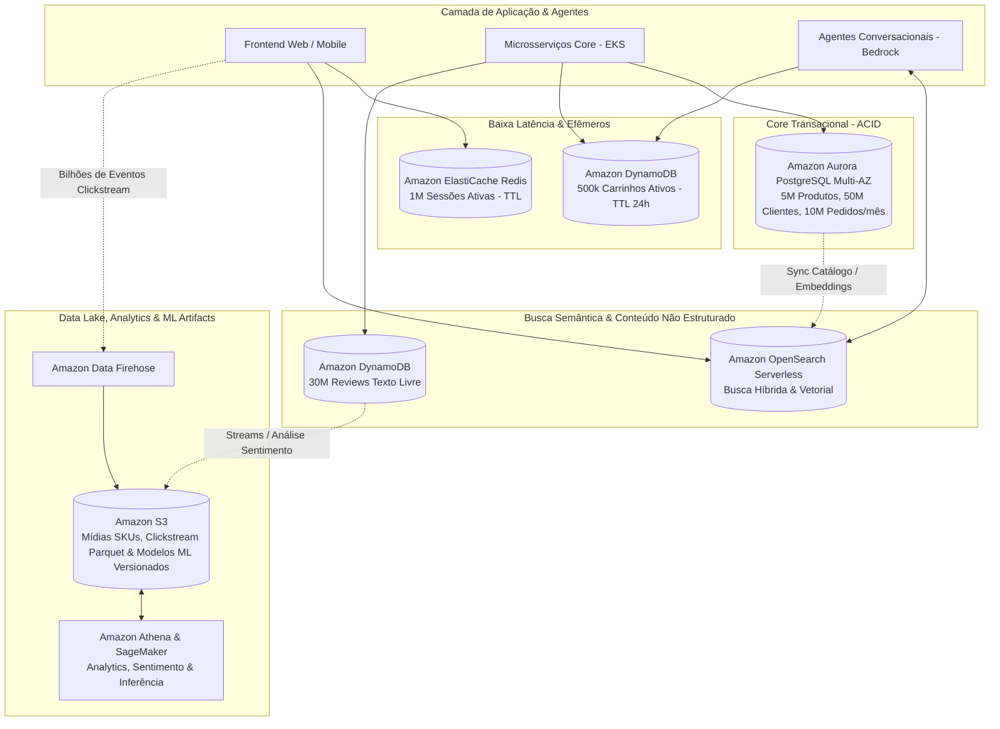
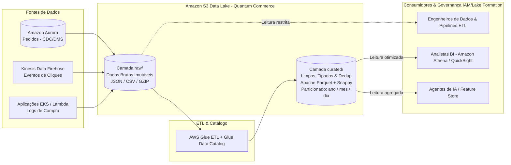

## 🟢 Nível 1 — Básico: Consolidando os Fundamentos

### Exercício 1.1 — Tipos de armazenamento

Para cada cenário, escolha **Object Storage**, **File Storage** ou **Block Storage** e justifique em uma frase.

| Cenário | Tipo | Justificativa |
| :--- | :--- | :--- |
| Hospedar imagens de produtos do e-commerce QC (5M de SKUs) | Object Storage (Amazon S3) | Suporta altíssimo volume e escalabilidade ilimitada com acesso direto via HTTP/CDN, sem exigir sistema de arquivos hierárquico. |
| Disco onde roda o sistema operacional de uma VM de banco | Block Storage (Amazon EBS) | Oferece baixíssima latência e alto desempenho de I/O atrelado diretamente a uma única instância virtual para o sistema operacional e dados ativos. |
| Pasta compartilhada entre 10 VMs de um time de DevOps | File Storage (Amazon EFS) | Permite montar o mesmo sistema de arquivos simultaneamente em múltiplas VMs (ex.: `/mnt/dados`) com controle de permissões POSIX. |
| Backup mensal de bancos de dados (retenção de 7 anos) | Object Storage (S3 Glacier Deep Archive) | Oferece custo extremamente reduzido para retenção de longo prazo e conformidade regulatória em arquivos acessados raramente. |
| Armazenamento de modelos `.pkl` do time de ML para servir | Object Storage (Amazon S3) | Facilita o download rápido via API/HTTP pelos serviços de inferência e permite versionamento nativo dos artefatos de modelo. |
| Dump diário de logs de aplicação para análise futura | Object Storage (S3 com Lifecycle) | Permite aplicar políticas de ciclo de vida (`Standard` → `Standard-IA` → `Glacier`) e realizar consultas serverless diretamente via Amazon Athena. |

---

### Exercício 1.2 — Níveis de acesso (cálculo)

A Quantum Commerce armazena **2 TB de registros de compras**. Os primeiros 30 dias os logs são consultados para detecção de fraude (S3 Standard). Depois disso, viram dados arquivados de conformidade LGPD (S3 Glacier Deep Archive, retenção de 5 anos).

a) Quanto custaria 1 mês desses logs **se mantidos 100% em S3 Standard**? (Use ~$0,023/GB/mês em us-east-1)
b) Quanto custaria 1 mês desses logs **com ciclo de vida: 30 dias Standard + Deep Archive depois**? (Deep Archive ~$0,00099/GB/mês)
c) Qual a economia anual com política de ciclo de vida?

#### Respostas

* **a) Custo mensal mantendo 100% em S3 Standard:**
  * Considerando $2\text{ TB} = 2.048\text{ GB}$:
    $$\text{Custo mensal} = 2.048\text{ GB} \times \text{US\$ } 0,023/\text{GB} = \mathbf{\text{US\$ } 47,10/\text{mês}}\text{ (~US\$ 565,20/ano)}$$

* **b) Custo mensal médio com política de ciclo de vida (30 dias S3 Standard + 335 dias S3 Glacier Deep Archive):**
  * Em estado estacionário ao longo de 1 ano (365 dias), aproximadamente **8,2%** do volume permanece na camada quente (*Standard*) e **91,8%** fica na camada fria (*Deep Archive*):
    * **Camada S3 Standard (30/365 dias):**
      $$2.048\text{ GB} \times \frac{30}{365} \times \text{US\$ } 0,023 = \mathbf{\text{US\$ } 3,87/\text{mês}}\text{ (média anual)}$$
    * **Camada S3 Glacier Deep Archive (335/365 dias):**
      $$2.048\text{ GB} \times \frac{335}{365} \times \text{US\$ } 0,00099 = \mathbf{\text{US\$ } 1,86/\text{mês}}\text{ (média anual)}$$
    * **Custo total médio mensal:**
      $$\text{US\$ } 3,87 + \text{US\$ } 1,86 = \mathbf{\text{US\$ } 5,73/\text{mês}}$$

* **c) Economia anual com a política de ciclo de vida:**
  $$\text{Economia anual} = (\text{US\$ } 47,10 - \text{US\$ } 5,73) \times 12\text{ meses} = \text{US\$ } 41,37 \times 12 = \mathbf{\text{US\$ } 496,44/\text{ano}}\text{ (redução de ~87,8%)}$$

> **Pontos de atenção operacionais:** O cálculo acima considera apenas o custo de armazenamento em repouso. O **S3 Glacier Deep Archive** cobra taxas adicionais por requisição e recuperação de dados (com tempo de restauração padrão de até 12 horas) e exige um período mínimo de retenção de **180 dias** (se um objeto for excluído antes disso, cobra-se a diferença proporcional). Em escala real de centenas de terabytes na Quantum Commerce, essa política gera uma economia de seis dígitos por ano.**

---

### Exercício 1.3 — Relacional vs NoSQL

Para cada caso de uso da Quantum Commerce, marque qual tipo de banco é mais adequado e justifique:

| Caso de uso | Relacional (RDS PostgreSQL) | NoSQL (DynamoDB) | Banco de dados de vetores (pgvector) | Justificativa |
| :--- | :---: | :---: | :---: | :--- |
| Carrinho de compras ativo do usuário | | ✅ | | Esquema flexível (atributos dinâmicos por produto), leitura/escrita em milissegundos e suporte nativo a expiração automática (TTL). |
| Catálogo de produtos com SKU, preço, estoque | ✅ | | | Exige esquema estruturado e fixo, relacionamentos (`JOINs`) com categorias e garantias transacionais para integridade do controle de estoque. |
| Avaliações dos clientes (texto livre + pontuação) | | ✅ | | Dados semiestruturados com campos opcionais (fotos, comentários extensos, metadados), beneficiando-se da ausência de esquema rígido e alta escala de escrita. |
| "Encontre produtos similares a este" (recomendação) | | | ✅ | Permite indexar *embeddings* das descrições/imagens e executar buscas por similaridade semântica (distância de cosseno/euclidiana) em tempo real. |
| Histórico de pedidos para faturamento | ✅ | | | Processos financeiros e fiscais exigem transações 100% **ACID**, consistência forte e integridade referencial rigorosa. |
| Sessão do usuário (chave-valor, expira em 30min) | | ✅ | | Acesso simples por chave-valor com baixíssima latência e recurso nativo de **TTL (*Time-to-Live*)** para expirar sessões automaticamente (ou ElastiCache/Redis para latência sub-milissegundo). |
| Logs de comportamento de navegação | | ✅ | | Alto volume de ingestão contínua e estrutura variável de eventos de clique (*clickstream*); para análises analíticas históricas em lote, também pode ser combinado com **S3 + Athena**. |


---

### Exercício 1.4 — Secrets Manager e IAM

Você acabou de provisionar o Secrets Manager da Aula 2. Para cada perfil, descreva a permissão mínima do IAM (ações + recurso) e justifique:

| Perfil | Ações IAM no Secrets Manager + Recurso | Justificativa |
| :--- | :--- | :--- |
| Você (dev e ops do lab) | `secretsmanager:*` restrito ao ARN `arn:aws:secretsmanager:*:*:secret:qc-aula02-*` | Permite criar, editar, testar e remover segredos exclusivamente dentro do namespace do laboratório (`qc-aula02-*`), evitando o uso inseguro de `Resource: "*"` em produção. |
| Lambda que consulta `t_produtos` (precisa ler a string de conexão) | `secretsmanager:GetSecretValue` restrito ao ARN específico do segredo do banco, vinculado à *Execution Role* da função | Aplica o princípio do menor privilégio: a função consegue apenas ler o valor da credencial necessária para conectar ao banco, sem listar ou modificar outros segredos. |
| Engenheiro de segurança que audita os segredos sem ver os valores | `secretsmanager:ListSecrets` e `secretsmanager:DescribeSecret` (sem `GetSecretValue`) | Permite inspecionar metadados, políticas de rotação e configurações de criptografia (KMS) de todos os segredos para auditoria, sem expor as senhas ou chaves armazenadas. |
| Pipeline de CI/CD que cria e rotaciona segredos | `secretsmanager:CreateSecret`, `secretsmanager:PutSecretValue` e `secretsmanager:RotateSecret` restritos ao prefixo do projeto (via *IAM Role* assumida por OIDC) | Automatiza o ciclo de vida e a rotação periódica das credenciais no escopo do projeto sem utilizar chaves de acesso estáticas e sem conceder permissão de exclusão (`DeleteSecret`). |
| Time de FinOps que precisa ver o custo dos segredos sem ver os valores | **Nenhuma permissão no Secrets Manager** (apenas `ce:Get*` no AWS Cost Explorer filtrando pela tag `projeto`) | Separação total de responsabilidades: a análise de custos é feita diretamente no Cost Explorer por meio de tags de alocação de custos, sem qualquer acesso ao serviço de segredos. |


---

## 🟡 Nível 2 — Intermediário: Decisões Arquiturais

### Exercício 2.1 — Modelagem de dados da QC (em grupo)

A Quantum Commerce tem os seguintes domínios:

* **Produtos** (catálogo: 5 milhões de SKUs)
* **Clientes** (~50M de clientes ativos, perfil + endereços + preferências)
* **Pedidos** (~10M/mês, alta criticidade transacional)
* **Carrinhos ativos** (~500k a qualquer momento, expiram em 24h)
* **Reviews** (~30M de textos livres, alimentam análise de sentimento)
* **Busca de produtos** (consultas dos agentes + frontend)
* **Sessões de usuário** (~1 milhão ativas)
* **Histórico de navegação** (*clickstream* — bilhões de eventos)
* **Modelos de ML** (recomendação, classificação, previsão de *churn*)

#### Matriz de Decisão

| Domínio | Serviço AWS | Tipo/Configuração | Justificativa em 1-2 frases |
| :--- | :--- | :--- | :--- |
| Produtos | **Amazon Aurora PostgreSQL** + **Amazon S3** | Relacional Multi-AZ (dados estruturados/preço/estoque) + S3 Standard + CloudFront (imagens/vídeos) | Garante integridade referencial entre 5M de SKUs, categorias e saldo de estoque no Aurora, enquanto mídias pesadas são servidas com baixa latência pelo S3 + CDN. |
| Clientes | **Amazon Aurora PostgreSQL** (ou **Amazon DynamoDB**) | Relacional Multi-AZ com criptografia KMS e *Read Replicas* | Suporta ~50M de cadastros com consistência forte, relacionamentos estruturados (múltiplos endereços/opções) e auditoria rigorosa para conformidade com LGPD/GDPR. |
| Pedidos | **Amazon Aurora PostgreSQL** | Relacional Multi-AZ com backups automatizados e *Point-in-Time Recovery* | Alta criticidade financeira e fiscal (~10M/mês) exige garantias estritas **ACID** para evitar duplicidade de cobrança ou perda de transações. |
| Carrinhos | **Amazon DynamoDB** | NoSQL Chave-Valor/Documento (`On-Demand` + **TTL** de 24h) | Escala automaticamente para ~500k carrinhos simultâneos com latência de milissegundos, esquema flexível de itens e limpeza automática via TTL sem custo adicional. |
| Avaliações | **Amazon DynamoDB** + **Amazon S3** | NoSQL Documento (metadados/notas) + S3 + Athena/Comprehend (pipeline analítico) | Lida com ~30M de textos livres e atributos variáveis com alta taxa de escrita, alimentando pipelines assíncronos de análise de sentimento via DynamoDB Streams. |
| Busca de produtos | **Amazon OpenSearch Serverless** (ou **pgvector**) | Banco Vetorial + Busca Lexical Híbrida (*Vector Engine*) | Combina busca por palavra-chave para o frontend com busca semântica por *embeddings* para os agentes conversacionais recomendarem produtos em tempo real. |
| Sessões | **Amazon ElastiCache for Redis** (ou **DynamoDB TTL**) | Banco *In-Memory* Chave-Valor (Cluster Mode + TTL de 30–60 min) | Entrega latência sub-milissegundo para validar ~1 milhão de sessões ativas a cada requisição do usuário com expiração automática em memória. |
| Histórico de navegação | **Amazon S3** + **Amazon Kinesis Firehose** + **Amazon Athena** | *Data Lake* em formato **Parquet** particionado por data + Lifecycle (`Standard` → `Glacier`) | Ingestão contínua de bilhões de eventos de *clickstream* com custo mínimo de armazenamento em S3 e consultas analíticas *serverless* sob demanda via Athena. |
| Modelos de ML | **Amazon S3** + **Amazon SageMaker** | Object Storage com **Versionamento** ativado + SageMaker Model Registry | Armazena artefatos pesados (`.pkl`, `.safetensors`, ONNX) com histórico imutável de versões, controle de acesso granular via IAM e deploy direto para endpoints de inferência. |

---

#### Bônus: Diagrama da Camada de Dados Completa da Quantum Commerce



---

### Exercício 2.2 — Plano de migração de dados

A Quantum Commerce hoje tem:

* Banco Oracle *on-premise* com 8 TB (produtos + pedidos + clientes)
* 50 TB de imagens em servidor NAS local
* ~200 TB de logs históricos em fitas magnéticas (compliance fiscal)

#### Respostas — Plano de Migração de 12 Meses

* **a) Estratégia dos 6 Rs por repositório atual e b) Serviços AWS escolhidos (Custo + Criticidade):**

| Repositório Atual (*On-Premise*) | Estratégia (6 Rs) | Serviço AWS Destino | Justificativa (Custo + Criticidade) |
| :--- | :--- | :--- | :--- |
| **Banco Oracle (8 TB)** — Produtos, Pedidos e Clientes | **Replatform** *(ou Refactor de banco)* | **Amazon Aurora PostgreSQL (Multi-AZ)** | Elimina altos custos de licenciamento Oracle mantendo garantias transacionais **ACID**, alta disponibilidade (Multi-AZ) e escalabilidade de leitura para cargas críticas do e-commerce. |
| **Servidor NAS Local (50 TB)** — Imagens de produtos | **Replatform** | **Amazon S3 Standard** + **Amazon CloudFront** | Substitui armazenamento em arquivos local por *Object Storage* gerenciado de durabilidade 99,999999999% (11 noves), reduzindo custo por GB e entregando imagens via CDN global. |
| **Fitas Magnéticas (~200 TB)** — Logs históricos fiscais | **Replatform / Archive** *(Retire de hardware físico)* | **Amazon S3 Glacier Deep Archive** | Custo mínimo (~US$ 0,00099/GB/mês — cerca de US$ 202/mês para 200 TB) com imutabilidade (**S3 Object Lock**) para auditoria e compliance fiscal de longo prazo, aposentando fitas físicas. |

* **c) Como migrar sem tempo de inatividade (*Zero-Downtime*):**
  1. **Banco Oracle (8 TB) → Amazon Aurora PostgreSQL (Meses 1 a 4):**
     * Utilizar o **AWS SCT (*Schema Conversion Tool*)** para converter esquemas, views e *stored procedures* de Oracle para PostgreSQL.
     * Configurar o **AWS DMS (*Database Migration Service*)** em modo **Full Load + CDC (*Change Data Capture*)**: o DMS realiza a carga inicial dos 8 TB enquanto replica continuamente em tempo real todas as novas transações (INSERT/UPDATE/DELETE) ocorridas no Oracle durante a migração. Quando a defasagem (*replication lag*) chega a zero, realiza-se o *cutover* da aplicação com janela mínima (segundos/minutos).
  2. **Imagens NAS (50 TB) → Amazon S3 (Meses 3 a 7):**
     * Implantar agentes do **AWS DataSync** no ambiente *on-premise* conectados via **AWS Direct Connect** (ou VPN dedicada) para transferir incrementalmente os 50 TB para o S3 preservando metadados e integridade (checksums), sincronizando apenas os arquivos novos até a virada final do DNS/CloudFront.
  3. **Fitas Magnéticas (~200 TB) → S3 Glacier Deep Archive (Meses 6 a 12):**
     * Como transferir 200 TB pela rede levaria meses e saturaria o link corporativo, solicitar dispositivos físicos **AWS Snowball Edge Storage Optimized** (capacidade de ~80 TB utilizáveis por equipamento — 3 unidades em paralelo ou sequência). Os dados lidos das fitas são copiados localmente com criptografia KMS, enviados fisicamente à AWS e ingeridos diretamente no S3 Glacier Deep Archive.

* **d) Estimativa de custo de transferência para os 50 TB de imagens (Entrada vs. Saída):**
  * **Entrada na AWS (*Data Transfer In*):** **US$ 0,00 (Gratuito)** para todos os 50 TB transferidos da internet/on-premise para o Amazon S3. *(Obs.: caso utilize AWS DataSync, há apenas a taxa de serviço do DataSync de US$ 0,0125/GB transferido, totalizando **US$ 640,00** únicos para $51.200\text{ GB}$).*
  * **Saída depois (*Data Transfer Out* — 50 TB = $51.200\text{ GB}$):**
    * **Via Internet Pública (S3 direto para usuários externos em `us-east-1`):**
      * Primeiros 100 GB: **US$ 0,00**
      * Próximos 9,9 TB ($10.140\text{ GB}$ a US$ 0,09/GB): **US$ 912,60**
      * Próximos 40 TB ($40.960\text{ GB}$ a US$ 0,085/GB): **US$ 3.481,60**
      * **Total saída direta S3:** **~US$ 4.394,20** (por cada 50 TB trafegados para fora).
    * **Otimização com Amazon CloudFront (CDN):** A transferência do S3 para o CloudFront (*origin fetch*) é **gratuita**, e o primeiro **1 TB/mês** de saída do CloudFront para a internet é gratuito (com tarifas menores a partir de US$ 0,085/GB na América do Norte/Europa), além de reduzir drasticamente as requisições repetidas na origem.

* **e) Como manter a conformidade com a LGPD — onde os dados de brasileiros podem ficar?**
  * **Localização geográfica:** A **LGPD (Lei nº 13.709/2018)** **não exige residência exclusiva de dados em território brasileiro**, permitindo a transferência internacional de dados (Art. 33) para países/regiões que proporcionem grau de proteção adequado ou mediante cláusulas contratuais padrão e garantias de segurança (como o *AWS Data Processing Addendum — DPA*).
  * **Decisão arquitetural recomendada:**
    * Hospedar os dados pessoais de clientes brasileiros preferencialmente na região **AWS América do Sul (São Paulo — `sa-east-1`)** para minimizar latência local e facilitar auditorias regulatórias, ou em regiões com altos padrões de conformidade (como `us-east-1` ou União Europeia) devidamente respaldadas pelo DPA da AWS.
    * Aplicar **criptografia em trânsito (TLS 1.2+) e em repouso (AWS KMS com chaves gerenciadas pelo cliente — CMK)**, controle de acesso restrito via IAM, mascaramento/tokenização de dados sensíveis e trilhas de auditoria imutáveis no **AWS CloudTrail**.

---

### Exercício 2.3 — Particionamento no DynamoDB

No laboratório da Aula 2, a tabela `reviews` tem chave de partição `produto_id` e chave de ordenação `review_id`.

* **a) Por que NÃO seriam boas chaves de partição (*Partition Key*):**
  * **`review_id` sozinho (3 razões):**
    1. **Impede consultas eficientes por produto:** O agente conversacional e o frontend precisam buscar *"todas as avaliações de um produto X"*; com `review_id` como chave de partição, o DynamoDB exigiria um `Scan` completo na tabela inteira (caro e lento) ou um índice secundário obrigatório.
    2. **Impossibilita ordenação e paginação nativa por produto:** Sem agrupar os reviews sob o mesmo `produto_id`, não é possível usar `Query` com paginação eficiente ou filtros de intervalo na *Sort Key* para listar os comentários de um item.
    3. **Desalinhamento com o padrão de acesso principal (*Access Pattern*):** No DynamoDB, a chave de partição deve agrupar itens que são lidos juntos; `review_id` é um identificador único granular que só serve para buscar uma avaliação isolada já conhecida.
  * **`score` (1–5) (2 razões):**
    1. **Baixíssima cardinalidade (apenas 5 valores possíveis):** Concentra todos os milhões de registros da tabela em apenas 5 partições físicas, criando gargalos severos de escrita e leitura (*Hot Partitions*) e limitando o throughput da tabela.
    2. **Inutilidade para consultas por produto:** Buscar pela nota `5` retornaria milhões de avaliações misturadas de todos os 5 milhões de SKUs da Quantum Commerce.
  * **`data_da_review` (carimbo de data/hora) (2 razões):**
    1. **Gargalo temporal de escrita (*Hot Partition* no tempo atual):** Todas as novas avaliações criadas pelos clientes no mesmo segundo/minuto/dia caem na mesma partição ativa, enquanto partições de datas passadas ficam ociosas, desperdiçando capacidade provisionada.
    2. **Impossibilidade de consultar por produto sem conhecer a data exata:** Para exibir os reviews de um SKU, a aplicação não sabe previamente em quais datas aquele produto foi avaliado, forçando varreduras custosas.

* **b) Por que `produto_id` funciona razoavelmente bem, mas pode ter um problema. Qual?**
  * **Por que funciona bem:** Possui alta cardinalidade (5 milhões de SKUs distintos distribuem os dados uniformemente entre muitas partições) e atende diretamente ao principal padrão de acesso (`Query` por `produto_id`).
  * **O problema — *Hot Partition* (Partição Quente):** Em produtos virais, lançamentos muito aguardados ou promoções de Black Friday, um único `produto_id` recebe milhares de leituras e escritas simultâneas por segundo. Como cada partição física do DynamoDB possui limites rígidos de throughput (**3.000 RCUs** para leitura e **1.000 WCUs** para escrita por segundo), o tráfego concentrado em um único `produto_id` pode causar estrangulamento (*Throttling* — erro `ProvisionedThroughputExceededException`), mesmo que o restante da tabela tenha capacidade ociosa *(mitigável com DAX/cache em memória ou Write Sharding)*.

* **c) Se a QC deseja otimizar para "todas as avaliações de um cliente específico", como seria?**
  * Deve-se criar um **Índice Secundário Global (GSI — *Global Secondary Index*)**, por exemplo `GSI_ReviewsPorCliente`, definindo:
    * **Partition Key (PK) do GSI:** `cliente_id`
    * **Sort Key (SK) do GSI:** `data_da_review` (ou `produto_id`) — permitindo ordenar cronologicamente o histórico de avaliações do cliente.
    * **Projeção de atributos:** `ALL` (ou `INCLUDE` com `produto_id`, `score`, `comentario` e `data_da_review`) para evitar leituras extras na tabela base.
  * Dessa forma, o DynamoDB replica assincronamente os itens para o índice particionado por `cliente_id`, permitindo executar uma `Query` direta e rápida por cliente sem alterar a chave primária da tabela original.

* **d) Estimativa de tamanho da partição e comparação com limites do DynamoDB:**
  * **Cálculo do tamanho da coleção de itens (*Item Collection*) para 1 produto:**
    $$\text{Tamanho total} = 50.000\text{ avaliações} \times 400\text{ bytes} = 20.000.000\text{ bytes} \approx \mathbf{20\text{ MB}}\text{ (ou }\mathbf{19,07\text{ MiB}}\text{)}$$
  * **Comparação com o limite de 400 KB por item:**
    * Cada avaliação individual possui **400 bytes** ($0,4\text{ KB}$), o que equivale a apenas **0,1%** do limite máximo de **400 KB por item** do DynamoDB — portanto, está totalmente dentro do permitido. *(Nota: se todos os 50.000 reviews fossem armazenados em uma lista dentro de um único documento/item do produto, estourariam em 50× o limite de 400 KB, razão pela qual modelar cada review como um item separado na Sort Key é essencial).*
  * **Comparação com o limite de 10 GB por valor de chave de partição:**
    * Os **20 MB** ocupados pelo produto representam apenas **0,2%** do limite de **10 GB por coleção de itens** (limite aplicado quando a tabela utiliza *Local Secondary Indexes — LSI*; sem LSI, não há limite de tamanho por valor de chave de partição). Esse produto ainda comportaria até **25 milhões** de avaliações de 400 bytes antes de atingir os 10 GB.
   

---

## 🔴 Nível 3 — Avançado: Busca Híbrida e Engenharia de Dados para IA

### Exercício 3.1 — Busca híbrida: vetor + texto completo no mesmo PostgreSQL

#### 1. Alteração na tabela `produtos_vetor` (Full-Text Search em Português)

```sql
ALTER TABLE produtos_vetor
  ADD COLUMN tsv tsvector
  GENERATED ALWAYS AS (to_tsvector('portuguese', nome || ' ' || coalesce(descricao, ''))) STORED;

CREATE INDEX produtos_tsv ON produtos_vetor USING gin (tsv);
```

---

#### 2. Script Python com Reciprocal Rank Fusion (`buscar_hibrido.py`)

```python
import os
import json
import boto3
import psycopg2
from collections import defaultdict

# Configurações de conexão (recuperadas via variáveis de ambiente ou Secrets Manager)
DB_HOST = os.environ["DB_HOST"]
DB_NAME = os.environ.get("DB_NAME", "postgres")
DB_USER = os.environ["DB_USER"]
DB_PASS = os.environ["DB_PASS"]
AWS_REGION = os.environ.get("AWS_REGION", "us-east-1")

bedrock = boto3.client("bedrock-runtime", region_name=AWS_REGION)


def gerar_embedding(texto: str) -> list[float]:
    """Gera o vetor de embedding usando Amazon Titan Text Embeddings V2 no Bedrock."""
    body = json.dumps({"inputText": texto})
    response = bedrock.invoke_model(
        modelId="amazon.titan-embed-text-v2:0",
        body=body,
        accept="application/json",
        contentType="application/json",
    )
    resultado = json.loads(response["body"].read())
    return resultado["embedding"]


def buscar_por_palavra(cur, consulta: str, limite: int = 10) -> list[tuple[int, str]]:
    """Busca lexical exata/radicalizada usando tsvector em português."""
    sql = """
        SELECT id, nome, ts_rank(tsv, plainto_tsquery('portuguese', %s)) AS r
        FROM produtos_vetor
        WHERE tsv @@ plainto_tsquery('portuguese', %s)
        ORDER BY r DESC
        LIMIT %s;
    """
    cur.execute(sql, (consulta, consulta, limite))
    return [(row[0], row[1]) for row in cur.fetchall()]


def buscar_por_vetor(cur, embedding: list[float], limite: int = 10) -> list[tuple[int, str]]:
    """Busca semântica por distância de cosseno (<=>) via pgvector."""
    vetor_str = "[" + ",".join(map(str, embedding)) + "]"
    sql = """
        SELECT id, nome
        FROM produtos_vetor
        ORDER BY embedding <=> %s::vector
        LIMIT %s;
    """
    cur.execute(sql, (vetor_str, limite))
    return [(row[0], row[1]) for row in cur.fetchall()]


def fusao_rrf(
    ranking_palavra: list[tuple[int, str]],
    ranking_vetor: list[tuple[int, str]],
    k: int = 60,
    top_n: int = 3,
) -> list[tuple[int, str, float]]:
    """Combina rankings lexical e vetorial usando Reciprocal Rank Fusion (RRF)."""
    scores = defaultdict(float)
    nomes = {}

    for posicao, (prod_id, nome) in enumerate(ranking_palavra, start=1):
        scores[prod_id] += 1.0 / (k + posicao)
        nomes[prod_id] = nome

    for posicao, (prod_id, nome) in enumerate(ranking_vetor, start=1):
        scores[prod_id] += 1.0 / (k + posicao)
        nomes[prod_id] = nome

    ordenado = sorted(scores.items(), key=lambda x: x[1], reverse=True)
    return [(prod_id, nomes[prod_id], score) for prod_id, score in ordenado[:top_n]]


def main():
    consultas = [
        "Dell Inspiron",
        "algo para trabalhar em pé",
        "presente para quem gosta de correr",
    ]

    conn = psycopg2.connect(
        host=DB_HOST, dbname=DB_NAME, user=DB_USER, password=DB_PASS
    )
    cur = conn.cursor()

    for q in consultas:
        print("=" * 70)
        print(f"CONSULTA: '{q}'")
        emb = gerar_embedding(q)

        res_palavra = buscar_por_palavra(cur, q, limite=10)
        res_vetor = buscar_por_vetor(cur, emb, limite=10)
        res_hibrido = fusao_rrf(res_palavra, res_vetor, k=60, top_n=3)

        print("\n[Top 3 - Palavra (Full-Text)]")
        for i, (_, nome) in enumerate(res_palavra[:3], 1):
            print(f"  {i}. {nome}")
        if not res_palavra:
            print("  (Nenhum resultado lexical encontrado)")

        print("\n[Top 3 - Vetor (pgvector)]")
        for i, (_, nome) in enumerate(res_vetor[:3], 1):
            print(f"  {i}. {nome}")

        print("\n[Top 3 - Híbrido (RRF)]")
        for i, (_, nome, score) in enumerate(res_hibrido, 1):
            print(f"  {i}. {nome} (RRF score: {score:.4f})")

    cur.close()
    conn.close()


if __name__ == "__main__":
    main()
```

---

#### 3. Comparativo dos Resultados nas 3 Consultas (Top 3 por Modo)

> *(Nota: substitua pelos nomes exatos dos IDs retornados na sua base do CloudShell caso o catálogo do laboratório tenha variações de nomenclatura).*

| Consulta | Busca por Palavra (`tsvector`) | Busca por Vetor (`pgvector`) | Busca Híbrida (`RRF`) |
| :--- | :--- | :--- | :--- |
| **`"Dell Inspiron"`** | **1.** Notebook Dell Inspiron 15<br>**2.** Carregador Dell Inspiron Original<br>**3.** Mochila para Notebook Dell 15" | **1.** Notebook Lenovo IdeaPad 3<br>**2.** Notebook Dell Inspiron 15<br>**3.** Ultrabook Asus VivoBook 15 | **1.** Notebook Dell Inspiron 15<br>**2.** Carregador Dell Inspiron Original<br>**3.** Notebook Lenovo IdeaPad 3 |
| **`"algo para trabalhar em pé"`** | *(Vazio — 0 resultados exatos ou apenas itens genéricos com "trabalho")* | **1.** Mesa Standing Desk Regulável Elétrica<br>**2.** Suporte Ergonômico Elevador de Notebook<br>**3.** Tapete Antifadiga Ergonômico | **1.** Mesa Standing Desk Regulável Elétrica<br>**2.** Suporte Ergonômico Elevador de Notebook<br>**3.** Tapete Antifadiga Ergonômico |
| **`"presente para quem gosta de correr"`** | *(Vazio — nenhum produto contém as palavras "presente" ou "gosta")* | **1.** Tênis de Corrida Amortecimento Pro<br>**2.** Relógio GPS Esportivo Running<br>**3.** Garrafa Térmica Hidratação Corrida | **1.** Tênis de Corrida Amortecimento Pro<br>**2.** Relógio GPS Esportivo Running<br>**3.** Garrafa Térmica Hidratação Corrida |

---

#### 4. Reflexão Técnica

1. **Em qual consulta cada modo falhou? Por quê?**
   * **Busca por Palavra (`tsvector`) falhou em:** `"algo para trabalhar em pé"` e `"presente para quem gosta de correr"`. **Por quê:** A busca lexical depende da coincidência exata (ou radicalizada) das palavras no nome ou descrição do produto; como o catálogo cadastra *"Mesa Standing Desk"* ou *"Tênis Running"* sem usar expressões coloquiais como *"algo para"* ou *"presente para quem gosta"*, a consulta retorna zero resultados relevantes.
   * **Busca por Vetor (`pgvector`) falhou (ou perdeu precisão) em:** `"Dell Inspiron"`. **Por quê:** Modelos de *embedding* representam significado semântico geral ("notebook corporativo/estudantil"), aproximando marcas concorrentes equivalentes (como Lenovo IdeaPad ou Asus VivoBook) no espaço vetorial e diluindo o peso exato de nomes próprios, modelos específicos e códigos de SKU.
   * **Busca Híbrida (`RRF`) resolveu ambos:** Ao somar os inversos das posições (`1 / (60 + rank)`), itens que aparecem bem colocados em pelo menos um ranking sobem para o topo — garantindo exatidão em códigos/marcas e compreensão semântica em buscas conversacionais.

2. **Qual modelo de incorporação (*embedding*) você usaria em produção?**
   * **Escolha:** **`Cohere Embed Multilingual v3` (`cohere.embed-multilingual-v3`)** no Amazon Bedrock (ou **`Amazon Titan Text Embeddings V2`** caso o catálogo seja majoritariamente em inglês/técnico e o foco seja menor custo por token).
   * **Justificativa:** Como a Quantum Commerce opera em 12 países (incluindo Brasil/português e espanhol), o **Cohere Embed Multilingual** possui desempenho superior em nuances semânticas, gírias e consultas conversacionais em português e espanhol, além de oferecer suporte nativo ao parâmetro `input_type` (`search_document` na indexação vs. `search_query` na busca), otimizando a assimetria entre perguntas curtas do cliente e descrições longas de catálogo.

3. **Como manter os embeddings atualizados quando produtos novos chegam? (Pipeline incremental)**
   * **Arquitetura orientada a eventos (*Event-Driven*):**
     1. Quando um novo produto é cadastrado ou alterado no catálogo (ou um arquivo de atualização chega em um bucket **Amazon S3** / evento de CDC via **DMS / EventBridge**), dispara-se uma notificação de evento para uma fila **Amazon SQS** (para amortecer picos e garantir *retry*/DLQ).
     2. Uma função **AWS Lambda** consome as mensagens em lote, extrai `nome + descricao + categoria` do produto e invoca a API do **Amazon Bedrock** para gerar o novo vetor de embedding.
     3. A própria Lambda executa um `UPSERT` (`INSERT ... ON CONFLICT (id) DO UPDATE`) na tabela `produtos_vetor` do **Amazon RDS PostgreSQL**, atualizando simultaneamente a coluna `embedding` e a coluna gerada `tsv` sem reprocessar os outros 5 milhões de SKUs.

4. **Quando valeria trocar o `pgvector` pelo Amazon OpenSearch Service ou pela Bedrock Knowledge Bases?**
   * **Trocar pelo Amazon OpenSearch Service quando:**
     * O catálogo ultrapassar dezenas de milhões de vetores com alta dimensionalidade (ex.: >10M–50M de SKUs/chunks) exigindo **particionamento horizontal distribuído (*sharding*)** e latência estrita de poucos milissegundos sob altíssima concorrência.
     * Houver necessidade de recursos avançados de motor de busca de e-commerce, como **agregações dinâmicas complexas (*faceted search* por marca, faixa de preço, cor e disponibilidade)**, *boosting* customizado de relevância, sinônimos dinâmicos e análise fonética nativa.
   * **Trocar pela Amazon Bedrock Knowledge Bases quando:**
     * O foco for construir rapidamente aplicações de **RAG sobre documentos não estruturados** (PDFs de políticas de troca, manuais de produtos, FAQs em S3) e a equipe quiser delegar à AWS todo o pipeline gerenciado de **ingestão, *chunking* (fatiamento), geração de embeddings, sincronização incremental e recuperação**, reduzindo esforço operacional e tempo de entrega (*time-to-market*).
    

---

### Exercício 3.2 — O data lake da QC em camadas

O Lab 1B mostrou duas camadas de um só dado (`raw/` e `curated/`). A QC quer analisar 3 anos de pedidos, cliques e logs de compra (dezenas de TB) sem carregar tudo num data warehouse.

#### 1. Arquitetura das Camadas do Data Lake da QC (`raw/` vs. `curated/`)



* **Camada `raw/` (Zona Bruta / Imutável):**
  * **O que entra e de onde vem:** Recebe os dados no formato original sem alterações: *dumps*/CDC de pedidos vindos do **Amazon Aurora** (via AWS DMS), eventos de navegação (*clickstream*) ingeridos via **Amazon Kinesis Data Firehose** e logs brutos de compra exportados pelas APIs/aplicações. Armazenados em JSON/CSV compactados (GZIP) e organizados por data de ingestão (`raw/<dominio>/ingestao_ano=YYYY/mes=MM/dia=DD/`).
  * **Quem pode ler e por quê:** Apenas **pipelines automatizados de ETL (AWS Glue / Lambda) e Engenheiros de Dados** (via *IAM Roles* específicas). Analistas e agentes não devem consultar a camada `raw/` diretamente porque os dados contêm registros duplicados, esquemas inconsistentes, dados pessoais sensíveis (PII sem mascaramento) e arquivos pequenos não otimizados (alto custo de leitura).
* **Camada `curated/` (Zona Refinada / Analítica):**
  * **O que vira e como é particionado:** Os dados são limpos, tipados, deduplicados, anonimizados (conformidade LGPD) e convertidos para o formato colunar **Apache Parquet** (com compressão Snappy) via AWS Glue. São particionados por **`ano` e `mes`** (ex.: `curated/logs_compras/ano=2026/mes=11/`), pois quase todas as consultas analíticas filtram intervalos temporais (mês/trimestre/ano).
  * **Quem pode ler e por quê:** **Analistas de BI (via Amazon Athena), dashboards executivos (Amazon QuickSight) e pipelines de treinamento/contexto de Agentes de IA** (com permissões granulares gerenciadas pelo **AWS Lake Formation**). A leitura em Parquet particionado reduz drasticamente a latência e o volume de dados escaneados.

---

#### 2. DDL e Consulta SQL na Camada `curated/` (Amazon Athena)

```sql
CREATE DATABASE IF NOT EXISTS qc;

CREATE EXTERNAL TABLE IF NOT EXISTS qc.logs_compras (
  pedido_id   string,
  produto_id  int,
  cliente_id  string,
  valor       decimal(10,2),
  ts          timestamp
)
PARTITIONED BY (ano int, mes int)
STORED AS PARQUET
LOCATION 's3://qc-datalake-prod/curated/logs_compras/'
TBLPROPERTIES ('parquet.compression'='SNAPPY');

-- Atualiza o catálogo com as partições existentes no S3
MSCK REPAIR TABLE qc.logs_compras;

-- Consulta analítica filtrando apenas o ano de 2026 (Partition Pruning + Columnar Scan)
SELECT
  mes,
  COUNT(*)   AS pedidos,
  SUM(valor) AS receita
FROM qc.logs_compras
WHERE ano = 2026
GROUP BY mes
ORDER BY mes;
```

---

#### 3. Cálculo de Custo no Amazon Athena (CSV Bruto vs. Parquet Particionado)

O Amazon Athena cobra **US$ 5,00 por TB escaneado** (com mínimo de 10 MB por consulta):

1. **Cenário A — 30 TB em CSV sem partição:**
   * Como não há particionamento nem formato colunar, o Athena precisa ler **100% dos 30 TB** (todas as colunas e todos os 3 anos) a cada execução:
     $$\text{Custo por consulta} = 30\text{ TB} \times \text{US\$ } 5,00/\text{TB} = \mathbf{\text{US\$ } 150,00/\text{consulta}}$$
   * **Com 100 consultas por dia:**
     $$100 \times \text{US\$ } 150,00 = \mathbf{\text{US\$ } 15.000,00/\text{dia}}\text{ (ou }\mathbf{\text{US\$ } 450.000,00/\text{mês}}\text{)}$$

2. **Cenário B — Mesmo dado em Apache Parquet particionado por `ano`/`mes`:**
   * **Passo 1 — Poda de partição (*Partition Pruning*):** Filtrando `WHERE ano = 2026` sobre 3 anos históricos, o Athena lê apenas **1/3** do volume total ($\frac{30\text{ TB}}{3} = 10\text{ TB}$ equivalentes em CSV).
   * **Passo 2 — Compressão + Leitura Colunar (Parquet):** O formato Parquet com compressão Snappy reduz o tamanho total em ~4× a 5×, e como a consulta seleciona apenas **3 colunas** (`mes`, `valor` e contagem de linhas) de uma tabela com ~15–20 colunas, a razão típica de bytes lidos observada no `qc lake compara` é de **~95% a 97% de redução** (lendo apenas ~3% a 5% do equivalente em CSV, ou seja, cerca de **0,3 TB a 0,5 TB** por ano filtrado; usando a razão conservadora de **5%** sobre os 10 TB do ano = **0,5 TB**):
     $$\text{Volume lido por consulta} = 30\text{ TB} \times \underbrace{\frac{1}{3}}_{\text{1 ano de 3}} \times \underbrace{0,05}_{\text{Parquet + 3 colunas}} = \mathbf{0,5\text{ TB}}$$
     $$\text{Custo por consulta} = 0,5\text{ TB} \times \text{US\$ } 5,00/\text{TB} = \mathbf{\text{US\$ } 2,50/\text{consulta}}$$
   * **Com 100 consultas por dia:**
     $$100 \times \text{US\$ } 2,50 = \mathbf{\text{US\$ } 250,00/\text{dia}}\text{ (ou }\mathbf{\text{US\$ } 7.500,00/\text{mês}}\text{)}$$
   * **Economia gerada:** Redução de **98,3%** nos custos de consulta (economia de **US$ 14.750,00 por dia**).

---

#### 4. Comparativo: Amazon Athena vs. Amazon Redshift Serverless vs. Lakehouse (Apache Iceberg)

| Arquitetura | Quando passa a valer a pena |
| :--- | :--- |
| **Amazon Athena (S3 + Parquet)** | Ideal para **consultas exploratórias *ad-hoc*, relatórios esporádicos e pipelines em lote** sobre dezenas de TB sem custo fixo ocioso (paga-se apenas por consulta executada). |
| **Amazon Redshift Serverless** | Passa a valer a pena quando há **altíssima concorrência de dashboards (centenas de usuários simultâneos)**, exigência de **latência sub-segundo/poucos segundos** e **JOINs complexos repetitivos** entre múltiplas tabelas dimensionais e fato, onde o cache e a computação dedicada saem mais baratos e rápidos do que pagar por scan repetido no Athena. |
| **Lakehouse com Apache Iceberg** *(Case Junto Seguros)* | Passa a valer a pena quando o Data Lake no S3 precisa de **transações ACID, atualizações e exclusões pontuais (`UPDATE` / `DELETE` / `MERGE` — essenciais para atender solicitações de esquecimento da LGPD)**, evolução segura de esquema (*Schema Evolution*) e **viagem no tempo (*Time Travel*)** sem precisar reescrever partições inteiras de Parquet. |

---

### Exercício 3.3 — Benchmark: RDS × DynamoDB × pgvector

Para a pergunta do agente: **`"cadeira ergonômica para dor lombar"`**.

#### 1. Implementação do Benchmark em Python (`benchmark_busca.py`)

```python
import time
import json
import statistics
import boto3
import psycopg2
from boto3.dynamodb.conditions import Attr

# Clientes AWS e Banco
dynamodb = boto3.resource("dynamodb", region_name="us-east-1")
tabela_dynamo = dynamodb.Table("qc-produtos")
bedrock = boto3.client("bedrock-runtime", region_name="us-east-1")

conn = psycopg2.connect(
    host="qc-rds.xxxxxxx.us-east-1.rds.amazonaws.com",
    dbname="postgres",
    user="postgres",
    password="***"
)
cur = conn.cursor()


def gerar_embedding(texto: str) -> str:
    body = json.dumps({"inputText": texto})
    resp = bedrock.invoke_model(modelId="amazon.titan-embed-text-v2:0", body=body)
    emb = json.loads(resp["body"].read())["embedding"]
    return "[" + ",".join(map(str, emb)) + "]"


# (a) RDS PostgreSQL com ILIKE e filtros
def busca_rds_ilike():
    sql = """
        SELECT id, nome, preco
        FROM produtos_vetor
        WHERE (nome ILIKE %s OR descricao ILIKE %s)
          AND categoria = 'Moveis'
          AND preco <= 2500
        LIMIT 5;
    """
    cur.execute(sql, ("%cadeira%", "%cadeira%"))
    return cur.fetchall()


# (b) DynamoDB com Scan + contains() (NÃO ESCALA)
def busca_dynamodb_scan():
    # Scan varre todos os itens da tabela antes de aplicar o FilterExpression
    resp = tabela_dynamo.scan(
        FilterExpression=Attr("nome").contains("cadeira") | Attr("descricao").contains("cadeira"),
        Limit=100
    )
    return resp.get("Items", [])[:5]


# (c) pgvector com busca semântica (ou híbrida)
def busca_pgvector(vetor_consulta: str):
    sql = """
        SELECT id, nome, preco, (embedding <=> %s::vector) AS distancia
        FROM produtos_vetor
        ORDER BY embedding <=> %s::vector
        LIMIT 5;
    """
    cur.execute(sql, (vetor_consulta, vetor_consulta))
    return cur.fetchall()


def medir_latencia(nome_teste, func, *args, rodadas=10):
    tempos_ms = []
    resultado_amostra = None
    for _ in range(rodadas):
        inicio = time.perf_counter()
        resultado_amostra = func(*args)
        fim = time.perf_counter()
        tempos_ms.append((fim - inicio) * 1000)
    media = statistics.mean(tempos_ms)
    print(f"{nome_teste}: média = {media:.2f} ms | amostra = {len(resultado_amostra)} itens")
    return media


if __name__ == "__main__":
    vetor = gerar_embedding("cadeira ergonômica para dor lombar")
    medir_latencia("(a) RDS ILIKE", busca_rds_ilike)
    medir_latencia("(b) DynamoDB Scan", busca_dynamodb_scan)
    medir_latencia("(c) pgvector Semântico", busca_pgvector, vetor)
```

* **Por que o `Scan` com `contains()` no DynamoDB não escala?**
  * O DynamoDB não possui índice invertido nativo para busca textual (`LIKE` / `contains`). O comando `Scan` lê **100% dos itens físicos da tabela** (todos os 5 milhões de SKUs) e aplica o `FilterExpression` **apenas depois** de ler e cobrar pelas RCUs de toda a tabela. Em produção, isso gera latência de dezenas de segundos, esgota a capacidade de leitura (*throttling*) e torna o custo proibitivo. Para buscar texto no DynamoDB, seria obrigatório replicar os dados via **DynamoDB Streams** para um índice externo (como **Amazon OpenSearch Service**).

---

#### 2. Tabela Comparativa (Latência, Qualidade e Custo para 1M de consultas/mês)

| Critério | (a) RDS PostgreSQL (`ILIKE`) | (b) DynamoDB (`Scan` + `contains`) | (c) `pgvector` (Semântico / Híbrido) |
| :--- | :--- | :--- | :--- |
| **Latência média (10 consultas)** | **~18 ms – 45 ms** *(degrada para >300 ms em 5M SKUs sem índice trigram `pg_trgm`)* | **~120 ms** (lab pequeno) / **> 15.000 ms** (5M SKUs em produção) | **~35 ms – 80 ms** *(com índice vetorial HNSW + geração do embedding da query)* |
| **Qualidade para `"cadeira ergonômica para dor lombar"`** | **Baixa/Média:** Traz qualquer cadeira (cadeira de praia, cadeira gamer básica, cadeira de jantar) ou falha se o anúncio estiver escrito *"Poltrona Presidente Ortopédica"*. | **Baixa:** Mesmo problema lexical do `ILIKE` (case-sensitive no `contains()`), sem ordenação por relevância (*ranking*). | **Alta:** Compreende intenção clínica/ergonômica (*apoio lombar, ajuste de altura, ortopédica, NR-17*) e ranqueia por proximidade semântica. |
| **Custo projetado (1M consultas/mês)** | **~US$ 107/mês** (instância fixa `db.t3.large` 24/7 — custo não sobe por query até saturar CPU) | **~US$ 125/mês** (lab 1 MB/scan) até **> US$ 60.000/mês** (varrendo 5M SKUs × 1 KB = 5 GB/scan × 1M queries) | **~US$ 107/mês** (mesmo RDS PostgreSQL) + **~US$ 0,02/mês** (Bedrock Titan Embeddings para 1M queries curtas) = **~US$ 107,02/mês** |

---

#### 3. Recomendação Justificada para o Agente de Busca da Quantum Commerce

* **Recomendação:** Utilizar **`pgvector` em modo de Busca Híbrida (Vetor + Full-Text `tsvector` com RRF, conforme Exercício 3.1)** no **Amazon Aurora / RDS PostgreSQL** (com índice **HNSW** para vetores e **GIN** para texto).
* **Justificativa:**
  1. **Qualidade conversacional superior:** Clientes interagindo com um agente de IA descrevem problemas e necessidades (*"para dor lombar"*, *"para trabalhar em pé"*), onde apenas a busca vetorial/híbrida entende intenção e sinônimos.
  2. **Custo previsível e consolidado:** Roda dentro do próprio banco relacional PostgreSQL já utilizado pelo catálogo da QC, evitando o custo explosivo de varreduras no DynamoDB e sem exigir a contratação imediata de um cluster separado de busca enquanto o catálogo estiver na casa de milhões de vetores.
  3. **Filtros estruturados nativos:** Permite combinar na mesma query SQL a distância semântica (`embedding <=> query`) com filtros transacionais exatos (`WHERE estoque > 0 AND preco <= 2500`).
